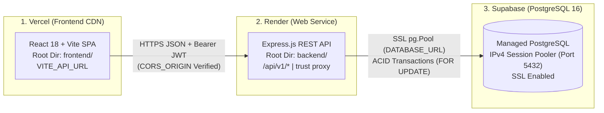

# Mad Max Gym — Cloud Production Deployment Guide (`Deployment.md`)

> **Target Cloud Architecture**: **Vercel (React 18 + Vite Frontend)** $\longrightarrow$ **Render (Node.js + Express REST API)** $\longrightarrow$ **Supabase (Managed PostgreSQL 16 Database)**



---

## 1. Prerequisites & Pre-Configured Cloud Enhancements

Before deploying, confirm your repository is pushed to **GitHub**, **GitLab**, or **Bitbucket**. The codebase includes the following built-in cloud-deployment configurations:

* **Automatic SSL for Remote PostgreSQL ([`backend/src/config/db.js`](./backend/src/config/db.js)):** Automatically enables `ssl: { rejectUnauthorized: false }` whenever `DATABASE_URL` points to a non-local cloud host (such as Supabase) or when `DB_SSL=true`.
* **Reverse-Proxy Rate Limiting ([`backend/src/server.js`](./backend/src/server.js)):** Sets `app.set('trust proxy', 1)` so `express-rate-limit` accurately tracks client IPs behind Render's load balancer.
* **Multi-Origin CORS Support ([`backend/src/server.js`](./backend/src/server.js)):** `CORS_ORIGIN` accepts a comma-separated list of allowed frontend domains (e.g., `https://mad-max-gym.vercel.app,http://localhost:4601`).
* **Vercel SPA Routing ([`frontend/vercel.json`](./frontend/vercel.json)):** Rewrites all client paths to `/index.html` while [`frontend/src/services/api.js`](./frontend/src/services/api.js) reads `VITE_API_URL` (or `VITE_API_BASE_URL`).

---

## 2. Step 1 — Deploy PostgreSQL Database on Supabase

### 2.1. Create the Supabase Project
1. Sign in to [Supabase Dashboard](https://supabase.com/dashboard) and click **New Project**.
2. Configure the project:
   * **Name:** `mad-max-gym-db`
   * **Database Password:** Generate a strong password (save it securely; avoid special URL characters like `@`, `#`, or `/` or URL-encode them as `%40`, `%23`, `%2F`).
   * **Region:** Select the region closest to your gym (e.g., **Southeast Asia (Singapore)** `ap-southeast-1` for the Philippines) and match this region on Render.
3. Click **Create new project** and wait ~60 seconds for provisioning to finish.

### 2.2. Copy the IPv4 Session Pooler Connection String (`DATABASE_URL`)
> **Important (Render IPv4 Compatibility):** Render Web Services use IPv4 egress by default, whereas Supabase's direct connection host (`db.<project-ref>.supabase.co`) is IPv6-only unless you use the **Supabase Supavisor Session Pooler**. Always use the **Session Pooler (`port 5432`)** connection string so PostgreSQL session-level `BEGIN ... COMMIT` transactions and `FOR UPDATE` row locks work over IPv4.

1. In your Supabase project, click the **Connect** button in the top header bar (or go to **Project Settings $\to$ Database**).
2. Select the **URI** tab and choose **Session Pooler** (Port `5432`, IPv4 compatible):
   ```text
   postgresql://postgres.<PROJECT_REF>:<YOUR_DB_PASSWORD>@aws-0-ap-southeast-1.pooler.supabase.com:5432/postgres
   ```
3. Copy this URI and replace `[YOUR-PASSWORD]` with your database password. This is your `DATABASE_URL`.

### 2.3. Run Schema Migrations & Seed Demo Data on Supabase
You can initialize your Supabase database from your local terminal before or after deploying Render:

```powershell
cd backend

# Temporarily point DATABASE_URL to your Supabase Session Pooler URI and run migrations + seed
$env:DATABASE_URL="postgresql://postgres.<PROJECT_REF>:<YOUR_DB_PASSWORD>@aws-0-ap-southeast-1.pooler.supabase.com:5432/postgres"
$env:DB_SSL="true"

# 1. Create all 14 tables, sequences (member_code_seq, invoice_number_seq), and indexes
npm run db:migrate

# 2. Seed demo staff accounts (ADMIN + FRONT_DESK), 7 PHP plans, and 12 sample members
npm run db:seed
```

*(Alternative: You can also paste the contents of [`backend/src/db/migrations/001_initial_schema.sql`](./backend/src/db/migrations/001_initial_schema.sql) directly into the **Supabase SQL Editor** and click **Run**, then run `npm run db:seed` to populate `bcryptjs` staff accounts and sample members.)*

---

## 3. Step 2 — Deploy Express.js Backend API on Render

### 3.1. Create a New Web Service on Render
1. Sign in to [Render Dashboard](https://dashboard.render.com/) and click **New + $\to$ Web Service**.
2. Connect your GitHub/GitLab repository (`Gym Management System`).
3. Configure the Web Service settings:

| Setting | Value |
| :--- | :--- |
| **Name** | `mad-max-gym-api` |
| **Region** | **Singapore (Southeast Asia)** *(match your Supabase region)* |
| **Branch** | `main` |
| **Root Directory** | `backend` |
| **Runtime** | `Node` |
| **Build Command** | `npm install && npm run db:migrate` *(or `npm install && npm run db:migrate && npm run db:seed` to auto-seed on deploy)* |
| **Start Command** | `npm start` |

### 3.2. Configure Render Environment Variables
Scroll down to **Environment Variables** in Render and add the following keys:

| Key | Value | Notes |
| :--- | :--- | :--- |
| `NODE_ENV` | `production` | Enforces production logging & 32+ char JWT secret check |
| `PORT` | `10000` | Render default internal port (automatically bound by `server.js`) |
| `DATABASE_URL` | `postgresql://postgres.<PROJECT_REF>:<PASSWORD>@aws-0-ap-southeast-1.pooler.supabase.com:5432/postgres` | Supabase **Session Pooler** URI (Port `5432`) |
| `DB_SSL` | `true` | Enables SSL (`rejectUnauthorized: false`) for Supabase |
| `JWT_SECRET` | `<64-char-random-hex-string>` | Generate via `node -e "console.log(require('crypto').randomBytes(48).toString('hex'))"` |
| `JWT_EXPIRES_IN` | `12h` | Staff shift JWT token lifetime |
| `CORS_ORIGIN` | `https://your-vercel-domain.vercel.app` | Comma-separated allowed origins (update once Vercel URL is generated in Step 3) |

### 3.3. Configure Health Check & Deploy
1. Expand **Advanced** in Render and set **Health Check Path** to:
   ```text
   /api/v1/health
   ```
2. Click **Create Web Service**.
3. Once deployed, copy your Render backend URL (e.g., `https://mad-max-gym-api.onrender.com`) and open:
   ```text
   https://mad-max-gym-api.onrender.com/api/v1/health
   ```
   Confirm it returns:
   ```json
   {
     "success": true,
     "data": {
       "status": "ok",
       "service": "mad-max-gym-api",
       "environment": "production",
       "database": {
         "connected": true,
         "name": "postgres"
       }
     }
   }
   ```

---

## 4. Step 3 — Deploy React 18 + Vite Frontend on Vercel

### 4.1. Import Project in Vercel
1. Sign in to [Vercel Dashboard](https://vercel.com/dashboard) and click **Add New... $\to$ Project**.
2. Import your `Gym Management System` Git repository.
3. Configure the **Project Settings**:

| Setting | Value |
| :--- | :--- |
| **Project Name** | `mad-max-gym` |
| **Framework Preset** | `Vite` |
| **Root Directory** | `frontend` *(click **Edit** next to Root Directory and select `frontend`)* |
| **Build Command** | `npm run build` |
| **Output Directory** | `dist` |
| **Install Command** | `npm install` |

### 4.2. Configure Vercel Environment Variables
Expand **Environment Variables** in Vercel and add:

| Key | Value (Example) | Environments |
| :--- | :--- | :--- |
| `VITE_API_URL` | `https://mad-max-gym-api.onrender.com/api/v1` | Production, Preview, Development |

> **Important:** Include `/api/v1` at the end of `VITE_API_URL` (no trailing slash needed).

### 4.3. Deploy & Complete the Render `CORS_ORIGIN` Handshake
1. Click **Deploy** in Vercel. Within ~45 seconds, Vercel assigns your production domain (e.g., `https://mad-max-gym.vercel.app`).
2. Copy your live Vercel URL (`https://mad-max-gym.vercel.app` — without a trailing slash).
3. Return to **Render Dashboard $\to$ `mad-max-gym-api` $\to$ Environment**, update `CORS_ORIGIN`:
   ```text
   https://mad-max-gym.vercel.app
   ```
   *(If you also want Vercel preview URLs or localhost to connect, separate them with commas: `https://mad-max-gym.vercel.app,http://localhost:4601`.)*
4. Click **Save Changes** in Render. Render will restart the service in ~15 seconds.

---

## 5. Post-Deployment Verification Checklist

Open your live Vercel URL (`https://mad-max-gym.vercel.app`) and verify the following 5 checkpoints:

1. **Staff Authentication & RBAC:**
   * Sign in with **Owner (`ADMIN`)**: `owner@madmaxgym.com` / `Admin123!` $\to$ verifies Vercel $\to$ Render JWT auth $\to$ Supabase `users` & `roles` query.
   * Sign in with **Front Desk (`FRONT_DESK`)**: `frontdesk@madmaxgym.com` / `Staff123!` $\to$ verifies role redirection to `/check-in` and `HTTP 403` protection on owner routes.
2. **2-Second Kiosk Sign-In & Cooldown Guard:**
   * Launch **Fullscreen Kiosk Mode** on `/check-in` and sign in with `0001` (`MEM-2026-0001` Marcus Reyes) $\to$ verify the **Green `ACCESS GRANTED`** banner and the 5-minute duplicate cooldown guard on a second scan.
3. **1-Step Walk-In Day Pass & 80mm Thermal Receipt:**
   * Open **Payments $\to$ Quick Walk-In Pass**, register a walk-in guest on `PASS-DAY` (`₱150.00`), and complete payment $\to$ verify `INV-YYYYMMDD-XXXX` sequence generation, 12% BIR VAT math, and `@media print` 80mm thermal receipt output with embedded QR Pass.
4. **Printable Member QR Pass Card:**
   * Open **Members $\to$ Kebab Menu (`⋮`) $\to$ View Member Pass** and click **Print QR Pass** $\to$ verify crisp SVG QR code and `@media print` isolation.
5. **Auto-Saved Merchant Payment QR Codes:**
   * Open **Gym Settings (`/settings`)**, upload a GCash/Maya QR image ($\le 2\text{ MB}$), and verify instant persistence to Supabase `store_settings.payment_qr_codes`.

---

## 6. Cloud Troubleshooting Quick Reference

| Symptom | Root Cause | Solution |
| :--- | :--- | :--- |
| **`connect ENETUNREACH` or IPv6 error on Render** | Using Supabase's direct IPv6 host (`db.<ref>.supabase.co:5432`) on an IPv4 Render instance. | Switch `DATABASE_URL` in Render to Supabase's **IPv4 Session Pooler URI** (`aws-0-<region>.pooler.supabase.com:5432`). |
| **`SSL connection is required` or `self-signed certificate in certificate chain`** | Cloud PostgreSQL requires TLS with `rejectUnauthorized: false`. | Set `DB_SSL=true` in Render Environment Variables (already auto-enabled for non-local `DATABASE_URL` in [`backend/src/config/db.js`](./backend/src/config/db.js)). |
| **CORS blocked in browser console on Vercel** | `CORS_ORIGIN` on Render does not match the exact Vercel URL or has a trailing slash. | Set `CORS_ORIGIN=https://your-app.vercel.app` (no trailing `/`) in Render Environment Variables. |
| **Render Free Tier 30–50s initial cold start** | Render's free web service spins down after 15 minutes of inactivity. | Ping `https://<your-render-service>.onrender.com/api/v1/health` every 10–14 minutes via an uptime monitor (e.g., UptimeRobot or Cron-Job.org) or upgrade to Render Starter. |
