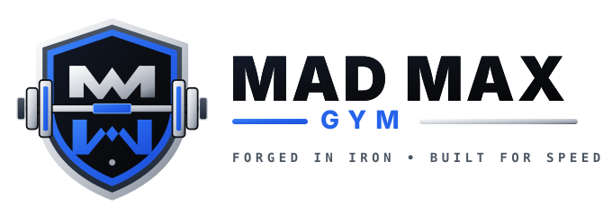

# Mad Max Gym — Membership Management, Usage Tracker & Fast Sign-In System



> *"Forged in Iron. Built for Speed."*  
> A high-performance, touch-friendly, full-stack gym management platform built with **React 18 (Vite + Tailwind CSS)**, **Node.js (Express.js)**, and **PostgreSQL 16 (Docker Compose)** following the **Tactile Metallic & Royal Blue Soft UI** design system ([`brand.md`](./brand.md)).

---

## 1. Core System Capabilities (6 Focused Modules)

| Module | Feature Specification | Highlights |
| :--- | :--- | :--- |
| **01. Auth & Staff RBAC** | [`docs/features/01-auth-and-staff-management/`](./docs/features/01-auth-and-staff-management/auth-and-staff-management.md) | Email + password login with eye-icon visibility toggle, `bcryptjs` hashing, `express-rate-limit` brute-force protection (`HTTP 429` after >5 failed attempts / 15m), `roles(code)` RBAC (`ADMIN` vs. `FRONT_DESK`), 540px `StaffDrawer`, `ResetPasswordModal`, and owner self-lockout guard. |
| **02. Membership Plans** | [`docs/features/02-membership-plans/`](./docs/features/02-membership-plans/membership-plans.md) | Hybrid catalog supporting **Walk-In Day Passes (`DAY_PASS`)**, **Recurring Time-Based Plans (`RECURRING`)**, and **Visit/Session Packs (`SESSION_PACK`)** with 12% Philippine BIR VAT-inclusive pricing, 540px `PlanDrawer`, 1-click plan duplication, and safe deactivation. |
| **03. Members & Subscriptions** | [`docs/features/03-members-and-subscriptions/`](./docs/features/03-members-and-subscriptions/members-and-subscriptions.md) | Concurrency-safe `MEM-YYYY-XXXX` generation via `member_code_seq`, unique phone enforcement (`HTTP 409`), printable **Member QR Pass Card (`MemberPassModal`)** with zero-dependency ISO/IEC 18004 SVG QR codes, and subscription **Freeze / Unfreeze** with automatic `end_date` extension by exact `frozen_days`. |
| **04. Fast Check-In & Usage** | [`docs/features/04-fast-check-in-and-attendance/`](./docs/features/04-fast-check-in-and-attendance/fast-check-in-and-attendance.md) | Dual-mode terminal: **Front-Desk Staff Lookup** + **Fullscreen Self-Service Kiosk Mode** (sign in within 2 seconds by `MEM-2026-0001`, 4-digit suffix `0001`, phone number, or QR scan), **5-Minute Duplicate Sign-In Cooldown Guard**, atomic `SESSION_PACK` deduction (`FOR UPDATE`), and password-guarded `"Exit Kiosk"` lock. |
| **05. Payments & 80mm Receipts** | [`docs/features/05-membership-payments-and-receipts/`](./docs/features/05-membership-payments-and-receipts/membership-payments-and-receipts.md) | Single-transaction enrollment & renewal checkout (`PaymentModal`), **1-Step Quick Walk-In Day Pass** guest registration, date-stacked renewals (`current_end_date + 1 day`), Cash quick bills, GCash/Maya QR counter zoom, concurrency-safe `INV-YYYYMMDD-XXXX`, **80mm Thermal Receipt (`ReceiptModal`)** with embedded Member QR Pass, and `ADMIN`-only payment voiding. |
| **06. Owner Dashboard & Settings** | [`docs/features/06-owner-dashboard-and-settings/`](./docs/features/06-owner-dashboard-and-settings/owner-dashboard-and-settings.md) | Executive analytics filtered by `Today`, `Last 7 Days`, and `This Month`, **Peak Gym Usage Hours (6 AM – 10 PM)** chart, **Expiring Soon ($\le 7$ days or $\le 2$ visits)** action queue with 1-click **`Renew`**, live 80mm receipt customizer, preset discount tiers, and instant auto-saved merchant payment QR codes. |

---

## 2. Quick Start

For full setup instructions and a **Guided 10-Step Walkthrough**, see [**`HOW_TO_RUN.md`**](./HOW_TO_RUN.md).

### Full Docker Compose Startup (3 Containers: `postgres`, `backend`, `web`)
```powershell
# 1. Build and start PostgreSQL (5435), Express API (4600), and React/Nginx Web (4601)
docker compose up -d --build

# 2. Apply idempotent SQL migrations and seed realistic Mad Max Gym demo data
cd backend
npm install
npm run db:migrate
npm run db:seed
```
* **Frontend Application & Kiosk:** [http://localhost:4601](http://localhost:4601)
* **Backend REST API Health:** [http://localhost:4600/api/v1/health](http://localhost:4600/api/v1/health)

*(Note: Per [`decisions.md`](./decisions.md) `UD-016`, default ports are `5435` / `4600` / `4601` to coexist with local Docker services on `5434` / `4500` / `4501`. See [`HOW_TO_RUN.md`](./HOW_TO_RUN.md) for standalone `5434` / `4500` / `4501` configuration.)*

---

## 3. Demo Login Credentials

| Role | Email Address | Password | Default Landing View |
| :--- | :--- | :--- | :--- |
| **Gym Owner (`ADMIN`)** | `owner@madmaxgym.com` | `Admin123!` | **Owner Dashboard** (`/dashboard`) |
| **Front-Desk Staff (`FRONT_DESK`)** | `frontdesk@madmaxgym.com` | `Staff123!` | **Fast Check-In Terminal** (`/check-in`) |

---

## 4. Repository Structure & Governance

* [`HOW_TO_RUN.md`](./HOW_TO_RUN.md) — Step-by-step developer & business-owner operational runbook and 10-step walkthrough.
* [`Deployment.md`](./Deployment.md) — Production cloud deployment runbook for **Vercel** (Frontend), **Render** (Backend API), and **Supabase** (PostgreSQL 16).
* [`brand.md`](./brand.md) — **Mad Max Gym** brand story, Obsidian Black / Gunmetal Gray / Royal Blue / Silver Gray tokens, typography, and SVG logo suite.
* [`decisions.md`](./decisions.md) — Chronological log of User Requirements & Feature Decisions (`UD-001` through `UD-020`).
* [`decision.md`](./decision.md) — Technical & Architectural Decision Records (`ADR-001` through `ADR-012`).
* [`rules/`](./rules/) — Modular operating, architectural, RBAC security, UI/UX, and phased workflow rules (`01` through `05`).
* [`docs/IMPLEMENTATION_PLAN.md`](./docs/IMPLEMENTATION_PLAN.md) — Master 7-Phase (Phase 0 to Phase 6) execution checklist (100% completed).
* [`docs/features/`](./docs/features/) — Zero-drift feature specifications (`01` through `06`) with ER diagrams, field validations, and behavioral acceptance criteria.
