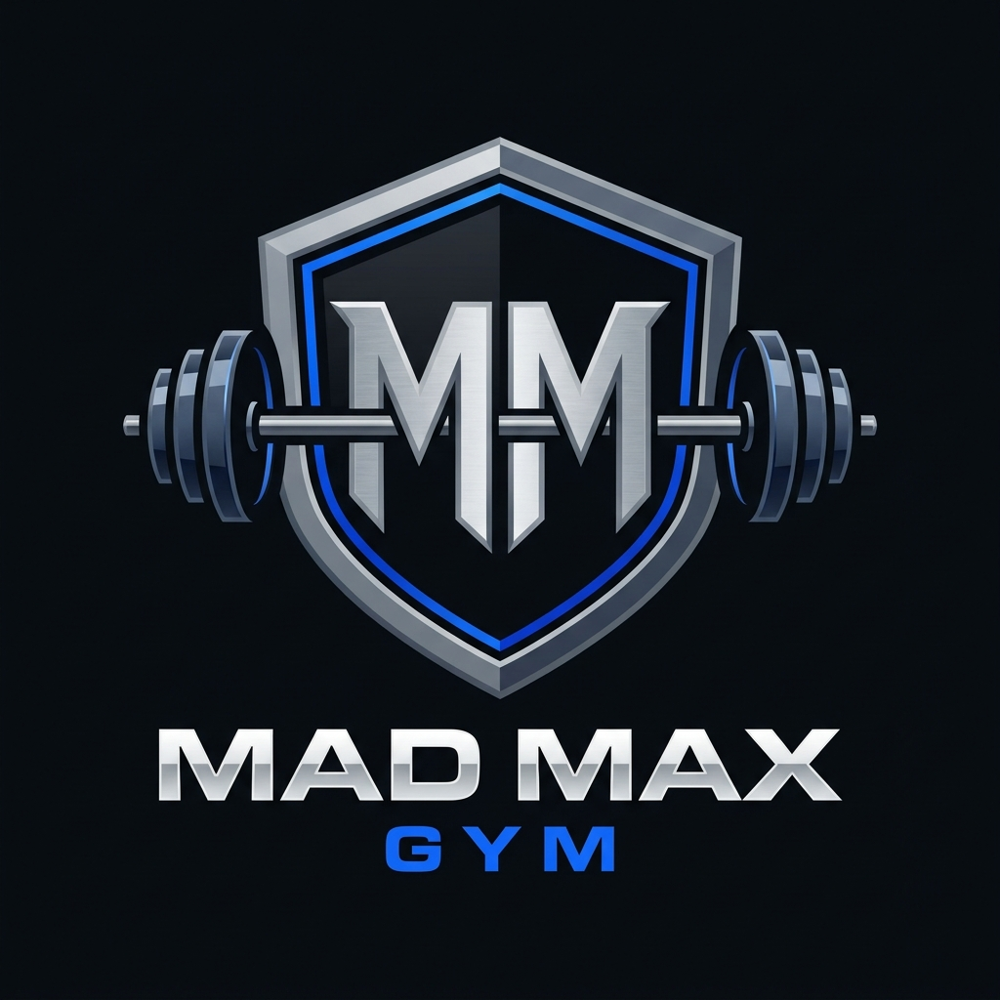
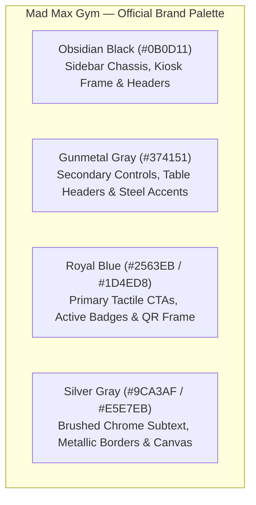

# Mad Max Gym — Brand Identity & Design System Guide (`brand.md`)

> **Brand**: **Mad Max Gym**  
> **Tagline**: *"Forged in Iron. Built for Speed."*  
> **Philosophy**: High-octane athletic intensity meets zero-friction front-desk precision.  
> **Design Language**: **Tactile Metallic & Royal Blue Soft UI** — obsidian black, industrial gunmetal gray, electric royal blue, and brushed silver gray with physical mechanical depth.

---

## 1. Brand Philosophy & Identity

### 1.1 Name Origin & Story
**Mad Max Gym** embodies raw strength, discipline, and high-performance training:
- **Obsidian Black & Gunmetal Gray**: Represent cast-iron plates, heavy steel power racks, and powder-coated industrial strength machines.
- **Royal Blue**: Symbolizes high-voltage athletic energy, focus, and precision—cutting cleanly through dark metallic surfaces to guide user actions.
- **Silver Gray**: Represents brushed chrome barbells, knurled steel handles, and crisp metallic instrument gauges.

In our **Gym Management & Fast Sign-In System**, **Mad Max Gym** stands for speed and clarity: an interface engineered so arriving athletes can sign in at the kiosk in under 2 seconds and the business owner can track memberships, visits, and revenue at a glance.

### 1.2 Core Brand Pillars
1. **2-Second Athlete Sign-In:** Kiosk and front-desk touch targets are $\ge 48\text{px}$ with instant auto-focus, immediate QR/Code recognition, and high-contrast visual feedback banners.
2. **Tactile Metallic Ergonomics:** Interfaces feel solid and mechanical. Primary Royal Blue buttons depress physically on tap, and cards sit on a clean Silver-Gray canvas with crisp metallic borders.
3. **Industrial Authority:** Moving away from generic pastel fitness templates into a bold, high-contrast **Black, Gray, Royal Blue, and Silver Gray** environment.
4. **Tabular Numeric Precision:** Membership IDs (`MEM-2026-0001`), remaining visit counters, days left, and Philippine Peso amounts (`₱1,500.00`) use bold tabular monospace typography to eliminate reading errors.

---

## 2. Official Visual Design Style: Tactile Metallic & Royal Blue Soft UI

### 2.1 Surface & Shadow Physics
Unlike flat digital interfaces, **Mad Max Gym** pairs a cool **Silver-Gray Canvas (`#F3F4F6`)** and **Pure White Cards (`#FFFFFF`)** with **Obsidian Black Chassis (`#0B0D11`)** and cool metallic elevation shadows:

```css
/* Metallic & Royal Blue Ambient Elevation Tokens */
--shadow-resting: 0 1px 3px rgba(11, 13, 17, 0.06), 0 4px 12px rgba(11, 13, 17, 0.04);
--shadow-floating: 0 4px 6px -1px rgba(11, 13, 17, 0.10), 0 12px 24px -4px rgba(29, 78, 216, 0.08);
--shadow-modal: 0 20px 30px -10px rgba(11, 13, 17, 0.28), 0 10px 15px -3px rgba(0, 0, 0, 0.15);
```

### 2.2 Physical Button Tap Physics (Royal Blue CTA)
Primary action buttons (`Sign In`, `Complete Payment`, `+ New Member`) are engineered to feel responsive and mechanical on front-desk touchscreens:

```css
/* Tactile Royal Blue Button Physical Depression */
.btn-tactile-royal {
  background: linear-gradient(180deg, #3B82F6 0%, #2563EB 60%, #1D4ED8 100%);
  border-top: 1px solid rgba(255, 255, 255, 0.30);
  box-shadow: 0 2px 0 #1E3A8A, 0 4px 10px rgba(37, 99, 235, 0.28);
  transition: all 75ms cubic-bezier(0.4, 0, 0.2, 1);
}

.btn-tactile-royal:active {
  transform: translateY(2px);
  box-shadow: 0 0 0 #1E3A8A, inset 0 2px 4px rgba(0, 0, 0, 0.35);
}
```

---

## 3. Visual Brand Assets (`docs/assets/`)

```
docs/assets/
├── mad_max_gym_logo.jpg                  # Master Raster Brand Logo (Shield & Heavy Barbell MM Crest)
├── mad-max-logo.svg                      # Master Vector SVG Lockup (Transparent Background)
├── mad-max-icon.svg                      # Standalone Shield & Barbell Emblem SVG (Transparent Background)
└── mad-max-badge.svg                     # Circular Member Pass & Receipt Stamp Seal (SVG)
```

### 3.1 Master Brand Logo
The official **Mad Max Gym** crest features an angular brushed-silver **Shield** with an **Electric Royal Blue (`#2563EB`)** inner rim, an **Obsidian Black (`#0B0D11`)** core, a heavy **3-plate Cast-Iron Barbell** horizontally interlocked across a bold metallic **"MM"** monogram, and industrial all-caps **"MAD MAX"** lettering above **"GYM"** in Royal Blue:



### 3.2 Vector Asset Hierarchy
- **[Full Logo Lockup (`mad-max-logo.svg`)](docs/assets/mad-max-logo.svg):** Horizontal shield crest paired with `"MAD MAX GYM"` and tagline `"FORGED IN IRON • BUILT FOR SPEED"`. Transparent background for Login and Kiosk headers.
- **[Standalone Shield Emblem (`mad-max-icon.svg`)](docs/assets/mad-max-icon.svg):** Compact Shield & Barbell `"MM"` mark for the 64px collapsed sidebar rail, browser favicon, and Kiosk watermark.
- **[Circular Stamp Badge (`mad-max-badge.svg`)](docs/assets/mad-max-badge.svg):** Official seal (`★ MAD MAX GYM ★ OFFICIAL MEMBER PASS • VERIFIED`) used on Member QR Pass Cards and 80mm thermal receipts.

---

## 4. Color Architecture & Design Tokens



### 3.1 Primary Brand Palette (Black, Gray, Royal Blue, Silver Gray)

| Token Name | Hex Code | RGB | Tailwind Class | UI Purpose & Behavior |
| :--- | :--- | :--- | :--- | :--- |
| **`obsidian-black`** | `#0B0D11` | `11, 13, 17` | `bg-[#0B0D11]` / `text-[#0B0D11]` | Collapsible sidebar rail, Fullscreen Kiosk background, modal header bars, primary headings. |
| **`carbon-black`** | `#111827` | `17, 24, 39` | `bg-gray-900` | Kiosk card surface, top terminal bar, dark badge backgrounds. |
| **`royal-blue`** | `#2563EB` | `37, 99, 235` | `bg-blue-600` / `text-blue-600` | Primary tactile CTA buttons, active sidebar indicator, Member QR Pass frame, plan price accents. |
| **`royal-blue-dark`** | `#1D4ED8` | `29, 78, 216` | `bg-blue-700` | Pressed button depth, hover state, active focus border. |
| **`royal-blue-light`**| `#DBEAFE` | `219, 234, 254`| `bg-blue-100` / `text-blue-800` | Selected member row highlight, active plan pill background, focus ring tint. |
| **`gunmetal-gray`** | `#374151` | `55, 65, 81` | `bg-gray-700` / `text-gray-700` | Secondary buttons, table column headers, form labels, SVG icon default strokes. |
| **`steel-gray`** | `#4B5563` | `75, 85, 99` | `text-gray-600` | Body copy, drawer subtitles, secondary metadata. |
| **`silver-gray`** | `#9CA3AF` | `156, 163, 175`| `text-gray-400` / `border-gray-400`| Metallic chrome subtext, Kiosk helper captions, inactive rail icons, badge borders. |
| **`silver-border`** | `#D1D5DB` | `209, 213, 219`| `border-gray-300` | Crisp 1px card outlines, input borders, table dividers. |
| **`silver-canvas`** | `#F3F4F6` | `243, 244, 246`| `bg-gray-100` | Primary backoffice background canvas; reduces glare while highlighting white cards. |
| **`pure-white`** | `#FFFFFF` | `255, 255, 255`| `bg-white` | Data tables, KPI cards, 540px slide-in drawers, centered payment modals. |

### 3.2 Status & Kiosk Feedback Tokens

| Status | Hex Code | Background Token | Text Token | Usage in Mad Max Gym |
| :--- | :--- | :--- | :--- | :--- |
| **Access Granted / Active** | `#059669` | `bg-emerald-50` | `text-emerald-700` | Kiosk `ACCESS GRANTED` welcome banner, `ACTIVE` subscription badge, payment complete. |
| **Expiring Soon / Frozen** | `#D97706` | `bg-amber-50` | `text-amber-700` | Membership $\le 3$ days or $\le 2$ visits left, `FROZEN` subscription status. |
| **Access Denied / Expired** | `#DC2626` | `bg-rose-50` | `text-rose-700` | Kiosk `ACCESS DENIED` banner, `EXPIRED` / `VOIDED` status, destructive confirmations. |
| **Visit Pack / Info** | `#2563EB` | `bg-blue-50` | `text-blue-700` | `SESSION_PACK` visit counter pills, Kiosk 5-minute duplicate sign-in notice. |

---

## 4. Typography System

### 4.1 Typeface Families
- **Display & Interface (`Inter`):** Clean, high-impact geometric sans-serif used for `"MAD MAX GYM"` headers, member names, form labels, and navigation.
- **Numbers, Codes & Currency (`Geist Mono` / `Roboto Mono`):** Enforces `tabular-nums` alignment for Member Codes (`MEM-2026-0001`), Invoice Numbers (`INV-20261121-0001`), remaining visit/day badges, and PHP prices (`₱1,500.00`).
- **Thermal Receipt Print (`Courier New`, monospace):** Used exclusively inside `@media print` for authentic 80mm thermal receipts.

### 4.2 Type Scale & Hierarchy

| Role | Font Size | Weight | Tracking | Usage |
| :--- | :--- | :--- | :--- | :--- |
| **Kiosk Banner Display** | `36px` (`2.25rem`) | ExtraBold (`800`) | `-0.03em` | Kiosk `"WELCOME, {NAME}!"` and `"ACCESS GRANTED / DENIED"` banners. |
| **Header 1** | `28px` (`1.75rem`) | Bold (`700`) | `-0.02em` | Main screen titles (*Fast Sign-In Terminal, Members, Owner Dashboard*). |
| **Header 2** | `20px` (`1.25rem`) | SemiBold (`600`) | `-0.01em` | 540px Drawer titles, modal headers, KPI section headers. |
| **Body (Base)** | `14px` (`0.875rem`) | Regular (`400`) | `normal` | Table rows, form inputs, drawer subtitles (`text-gray-600`). |
| **Small / Badge** | `12px` (`0.75rem`) | SemiBold (`600`) | `+0.03em` | Uppercase status pills (`ACTIVE`, `FROZEN`, `EXPIRED`), role badges. |
| **Financial & Code Mono**| `22px` – `30px` | ExtraBold (`800`) | `tight` | Total Payable (`₱`), Member Code (`MEM-2026-0001`), Visits Left counter. |

---

## 5. Voice, Tone & Humanized Messaging

**Mad Max Gym** uses clear, direct, encouraging, and humanized messages instead of technical error codes:

| Context | Generic / Robotic Message | Mad Max Gym Humanized Tone |
| :--- | :--- | :--- |
| **Login Error** | `HTTP 401: Unauthorized` | *"Invalid email or password. Please verify your credentials."* |
| **Kiosk Access Granted** | `Status 200: Check-in logged` | *"ACCESS GRANTED — Welcome back to Mad Max Gym, {Name}! ({X} days/visits left)"* |
| **Kiosk Duplicate Scan** | `Error: Cooldown active` | *"You are already signed in today at {HH:MM AM/PM}, {Name}! Have a great workout."* |
| **Kiosk Expired Plan** | `Error: Subscription expired` | *"ACCESS DENIED — Your membership expired on {Date}. Please see the Front Desk to renew."* |
| **Insufficient Cash** | `Tendered < Total` | *"Amount tendered (₱{tendered}) cannot be less than the total payable (₱{total})."* |
| **Receipt Footer** | `End of Receipt` | *"MAD MAX GYM • Keep your receipt or QR pass to sign in at the front desk kiosk!"* |
