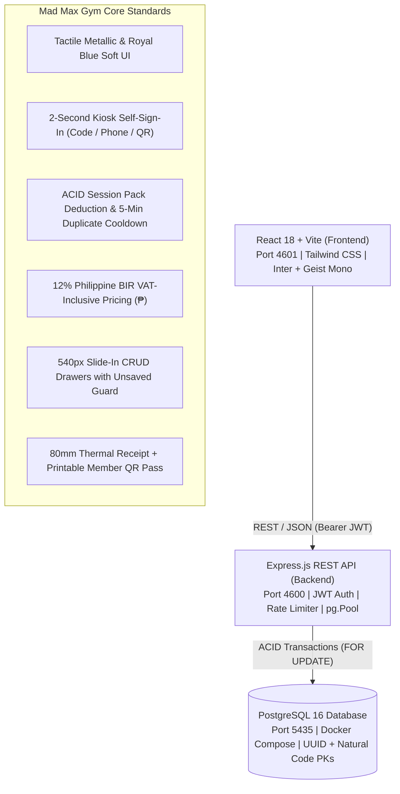
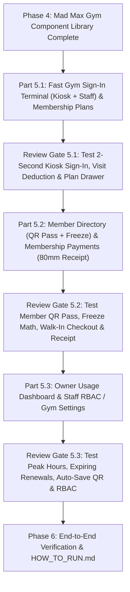

# Mad Max Gym — Master End-to-End Implementation Plan (`docs/IMPLEMENTATION_PLAN.md`)

> **System Project**: **Mad Max Gym — Membership Management, Usage Tracker & Fast Sign-In System**  
> **Tagline**: *"Forged in Iron. Built for Speed."*  
> **Tech Stack**: React 18 (Vite) + Tailwind CSS • Node.js (Express.js) • PostgreSQL 16 (Docker) • `node-postgres` (`pg.Pool`)  
> **Brand Identity ([`brand.md`](../brand.md))**: **Tactile Metallic & Royal Blue Soft UI** — Obsidian Black (`#0B0D11`), Gunmetal Gray (`#374151`), Royal Blue (`#2563EB`), and Silver Gray (`#9CA3AF` / `#F3F4F6`)  
> **Delivery Model**: **Phase 0 Skills Gate** $\to$ **Phases 1–4 Foundation** $\to$ **Phase 5: 3-Part Paired Screen Delivery (Parts 5.1 to 5.3 with Review Gates)** $\to$ **Phase 6: Verification & Runbook**

---

## 1. System Architecture & Golden Rules

### Core Architectural Mandates ([`rules/`](../rules/))
1. **Phase 0 Skills First ([`rules/01-operating-rules.md`](../rules/01-operating-rules.md)):** Before running `npm install` or `docker-compose up`, confirm and install the 9 required external agent skills listed in [`docs/required-skills.md`](./required-skills.md) into `.agents/skills/` (gitignored) and global skill paths.
2. **Primary Key Strategy ([`rules/02-architecture-and-db.md`](../rules/02-architecture-and-db.md)):**
   * **Entity & Transactional Tables** (`users`, `membership_plans`, `members`, `member_subscriptions`, `attendance_logs`, `payments`): `UUID` (`gen_random_uuid()`).
   * **Reference / Lookup Tables** (`roles`, `plan_types`, `genders`, `membership_statuses`, `payment_methods`, `payment_statuses`): Uppercase natural `code VARCHAR(30) PRIMARY KEY`.
3. **Concurrency-Safe Sequences:** Generate `MEM-YYYY-XXXX` (`member_code_seq`) and `INV-YYYYMMDD-XXXX` (`invoice_number_seq`) via PostgreSQL `nextval()`.
4. **ACID Pessimistic Locking (`FOR UPDATE`):** All membership checkouts, visit-pack check-in deductions, subscription freezes/unfreezes, and admin payment voids must execute inside `BEGIN ... COMMIT` blocks.
5. **12% BIR VAT-Inclusive Pricing & Price Freezing:** Menu prices are tax-inclusive ($\text{VAT} = \text{Total} - \text{Total} / 1.12$). Freeze `plan_price_at_purchase` and `plan_name_snapshot` at purchase time.
6. **UI/UX Standards ([`rules/04-ui-ux-standards.md`](../rules/04-ui-ux-standards.md)):** 540px slide-in CRUD drawers (`Drawer`) with subtitles and unsaved-changes guard modal, centered modals (`Modal`) for payment/80mm receipts/QR pass/voids, persistent collapsible sidebar rail with tooltips, in-column Kebab menus (`⋮`), shimmer skeletons, and zero-emoji 1.8px flat SVG icons (`SvgIcon`).

---

## 2. Implementation Phases Overview

| Phase | Title | Primary Objective | Deliverables / Gate |
| :--- | :--- | :--- | :--- |
| **Phase 0** | **Agent Skills Installation Gate** | Confirm, install & verify the 9 required skills before environment setup | 9 skills verified in `.agents/skills/` (gitignored) & global paths |
| **Phase 1** | **Environment & Foundation Setup** | Docker PostgreSQL 16, Express boilerplate, React 18 Vite + Mad Max Gym tokens | Postgres on `5435`, Express API on `4600`, React client on `4601` |
| **Phase 2** | **Database Modeling, Migrations & Seeds** | Complete relational schema, sequences, and realistic Mad Max Gym seed data | Numbered SQL migrations (`001`, `002`) + realistic PHP plans & members |
| **Phase 3** | **Backend REST API & ACID Services** | Layered Controllers & Services for all 6 modules with field validation | Auth JWT + Rate Limit, Plans, Members/Subscriptions, Fast Check-In, Payments, Dashboard |
| **Phase 4** | **Frontend Component Library & Shell** | Shared Tactile Metallic & Royal Blue Soft UI components | `AppShell`, `KioskShell`, 540px `Drawer` + Dirty Guard, `Modal`, `KebabMenu`, `SvgIcon`, `Skeleton` |
| **Phase 5** | **3-Part Paired Screen Delivery** | **3 focused parts, each pairing 2 screens with a dedicated Review Gate** | **Parts 5.1, 5.2, and 5.3** (6 core screens + 1 Login view) |
| **Phase 6** | **End-to-End Verification & Runbook** | Acceptance criteria audit, RBAC security test, 80mm print test & documentation | Zero-drift sync with `docs/features/01`–`06` & `HOW_TO_RUN.md` |

---

## 3. Detailed Foundation Phases (Phases 0 to 4)

---

### Phase 0: Mandatory Agent Skills Installation & Verification Gate
* [x] **0.1. User Confirmation via `ask_question`:**
  * Prompt the user to confirm installing the 9 official skills from [`docs/required-skills.md`](./required-skills.md):
    1. `frontend-design` (`anthropics/skills`)
    2. `web-design-guidelines` (`vercel-labs/agent-skills`)
    3. `react-best-practices` (`vercel-labs/agent-skills`)
    4. `ui-ux-pro-max` (`nextlevelbuilder/ui-ux-pro-max-skill`)
    5. `code-review` (`mattpocock/skills`)
    6. `backend-patterns` (`affaan-m/ECC`)
    7. `ui-animation` (`mblode/agent-skills`)
    8. `taste-skill` (`Leonxlnx/taste-skill`)
    9. `impeccable` (`pbakaus/impeccable`)
* [x] **0.2. Workspace & Global Installation:**
  * Install all confirmed skills into `.agents/skills/` and global skill paths (`~/.gemini/antigravity/skills/`, `~/.agents/skills/`).
* [x] **0.3. Manifest & `.gitignore` Verification:**
  * Verify every skill folder has a valid `SKILL.md` and confirm `.agents/` and `.agents/skills/` are ignored in [`.gitignore`](../.gitignore).

---

### Phase 1: Environment & Foundation Setup
* [x] **1.1. PostgreSQL 16 Container (`docker-compose.yml`):**
  * Configure PostgreSQL 16 service (`mad_max_gym_db`) mapped to host port `5435:5432` (reassigned from `5434` per `UD-016` to keep `copper-crema` running) with persistent volume `pgdata`.
  * Start container (`docker compose up -d postgres`) and verify health (`healthy`).
* [x] **1.2. Backend Scaffolding (`backend/`):**
  * Initialize Node.js project with `express`, `pg`, `cors`, `dotenv`, `jsonwebtoken`, `bcryptjs`, `express-rate-limit`, `morgan`, and `nodemon` on port `4600`.
  * Create `src/config/env.js` (boot validator ensuring cryptographic `JWT_SECRET`) and `src/config/db.js` (`pg.Pool` + `withTransaction`).
  * Create `src/middlewares/errorHandler.js` (standardized `{ success, data }` and `{ success: false, error: { message, code } }` envelopes) and `GET /api/v1/health`.
* [x] **1.3. Frontend Scaffolding (`frontend/`):**
  * Initialize React 18 + Vite client on port `4601`.
  * Configure Tailwind CSS with **Mad Max Gym** tokens from [`brand.md`](../brand.md):
    * `obsidian-black`: `#0B0D11`, `carbon-black`: `#111827`
    * `royal-blue`: `#2563EB`, `royal-blue-dark`: `#1D4ED8`, `royal-blue-light`: `#DBEAFE`
    * `gunmetal-gray`: `#374151`, `steel-gray`: `#4B5563`
    * `silver-gray`: `#9CA3AF`, `silver-border`: `#D1D5DB`, `silver-canvas`: `#F3F4F6`
  * Configure Google Fonts: *Inter* (UI & Display) and *Geist Mono / Roboto Mono* (`tabular-nums`).
  * Copy/link brand vector assets from `docs/assets/` (`mad-max-logo.svg`, `mad-max-icon.svg`, `mad-max-badge.svg`).

---

### Phase 2: Database Modeling, Migrations & Realistic Seed Data
* [x] **2.1. Migration `001_initial_schema.sql`:**
  * **PostgreSQL Sequences:** `member_code_seq` (`MEM-YYYY-XXXX`), `invoice_number_seq` (`INV-YYYYMMDD-XXXX`).
  * **Reference Tables (Natural `code` PKs):**
    * `roles`: `'ADMIN'`, `'FRONT_DESK'`
    * `plan_types`: `'DAY_PASS'`, `'RECURRING'`, `'SESSION_PACK'`
    * `genders`: `'MALE'`, `'FEMALE'`, `'NON_BINARY'`, `'PREFER_NOT_TO_SAY'`
    * `membership_statuses`: `'ACTIVE'`, `'FROZEN'`, `'EXPIRED'`, `'CANCELLED'`
    * `payment_methods`: `'CASH'`, `'DIGITAL_WALLET'`, `'CARD'`
    * `payment_statuses`: `'COMPLETED'`, `'VOIDED'`
  * **Entity & Transactional Tables (`UUID` PKs):**
    * `users`, `membership_plans`, `members`, `member_subscriptions`, `attendance_logs`, `payments`, and singleton `store_settings` (`id = 1`).
* [x] **2.2. Seed Script `backend/src/db/seed.js` & Runners (`db:migrate`, `db:seed`):**
  * **Demo Staff Accounts:**
    * Owner (`ADMIN`): `owner@madmaxgym.com` / `Admin123!`
    * Front Desk (`FRONT_DESK`): `frontdesk@madmaxgym.com` / `Staff123!`
  * **Mad Max Gym Membership Plans (12% BIR VAT-Inclusive PHP Pricing):**
    * `PASS-DAY`: *Walk-In Day Pass* (`DAY_PASS`, 1 Day, `₱150.00`)
    * `PLAN-WEEKLY`: *7-Day Power Pass* (`RECURRING`, 7 Days, `₱500.00`)
    * `PLAN-MONTHLY`: *Monthly Unlimited Iron* (`RECURRING`, 30 Days, `₱1,500.00`)
    * `PLAN-QUARTERLY`: *90-Day Strength Transformation* (`RECURRING`, 90 Days, `₱4,000.00`)
    * `PLAN-ANNUAL`: *365-Day Mad Max VIP* (`RECURRING`, 365 Days, `₱14,000.00`)
    * `PACK-10-VISITS`: *10-Visit Flex Pack* (`SESSION_PACK`, 10 Visits valid 90 Days, `₱1,200.00`)
    * `PACK-20-VISITS`: *20-Visit Warrior Pack* (`SESSION_PACK`, 20 Visits valid 180 Days, `₱2,200.00`)
  * **Sample Members & Usage Logs:**
    * 12 realistic gym members across `ACTIVE`, `EXPIRING SOON` ($\le 3$ days / $\le 2$ visits left), `FROZEN`, and `EXPIRED` states, plus realistic today/7-day `attendance_logs` and `payments`.

---

### Phase 3: Backend REST API & ACID Domain Services
* [x] **3.1. Module 1 — Auth & Staff Service (`auth.service.js`, `staff.service.js`):**
  * `POST /api/v1/auth/login` (with `express-rate-limit` 5 attempts / 15m per IP), `POST /api/v1/auth/forgot-password`, `GET /api/v1/auth/me`.
  * `GET /api/v1/staff`, `POST /api/v1/staff`, `PUT /api/v1/staff/:id`, `POST /api/v1/staff/:id/reset-password` (enforcing self-lockout guard).
* [x] **3.2. Module 2 — Membership Plans Service (`plan.service.js`):**
  * `GET /api/v1/plans`, `POST /api/v1/plans`, `PUT /api/v1/plans/:id`, `PATCH /api/v1/plans/:id/status` (enforcing conditional `included_sessions` vs. `duration_days` validation).
* [x] **3.3. Module 3 — Members & Subscriptions Service (`member.service.js`, `subscription.service.js`):**
  * `GET /api/v1/members` (paginated + instant search by name/phone/code), `POST /api/v1/members` (atomic `MEM-YYYY-XXXX`), `PUT /api/v1/members/:id`.
  * `POST /api/v1/subscriptions/:id/freeze` and `POST /api/v1/subscriptions/:id/unfreeze` (computing `frozen_days` and extending `end_date`).
* [x] **3.4. Module 4 — Fast Check-In & Usage Service (`checkin.service.js`):**
  * `POST /api/v1/check-in`: Single ACID transaction:
    1. Resolve member by exact `member_code`, 4-digit suffix (`0001`), or normalized `phone`.
    2. Check **5-Minute Duplicate Sign-In Cooldown Guard** (returns existing sign-in without double session deduction).
    3. Lock latest subscription (`FOR UPDATE`), evaluate expiration, and if `SESSION_PACK`, decrement `remaining_sessions` by 1.
    4. Insert `attendance_logs` (`GRANTED`, `DENIED_EXPIRED`, `DENIED_FROZEN`, or `DENIED_NO_PLAN`) and update `members.total_visits`.
  * `POST /api/v1/check-in/verify-exit`: Verifies staff password before exiting Fullscreen Kiosk Mode.
  * `GET /api/v1/check-in/logs`: Paginated usage ledger with date range and status filters.
* [x] **3.5. Module 5 — Membership Payments & Void Service (`payment.service.js`):**
  * `POST /api/v1/payments`: Single ACID transaction supporting both existing members and **1-Step Quick Walk-In Day Pass** guest registration, date-stacked renewals, 12% BIR VAT-inclusive math, sequence-generated `INV-YYYYMMDD-XXXX`, and optional automatic check-in.
  * `GET /api/v1/payments`: Paginated invoice ledger with date filters.
  * `POST /api/v1/payments/:id/void`: Owner-only (`ADMIN`), requires `void_reason >= 5` chars, marks payment `'VOIDED'` and cancels linked subscription.
* [x] **3.6. Module 6 — Owner Dashboard & Gym Settings Service (`dashboard.service.js`, `settings.service.js`):**
  * `GET /api/v1/dashboard/summary?period=today|7d|month`: Returns sign-in traffic, peak check-in hours (`6 AM`–`10 PM`), active members split, expiring-soon alert rows ($\le 7$ days or $\le 2$ visits), and revenue breakdown.
  * `GET /api/v1/settings`, `PUT /api/v1/settings`, and auto-save endpoint `PUT /api/v1/settings/qr-codes`.

---

### Phase 4: Frontend Reusable Component Library (`Mad Max Gym` Soft UI)
* [x] **4.1. Navigation & Terminal Shells:**
  * `AppShell.jsx`: 230px Obsidian Black (`#0B0D11`) collapsible sidebar with `mad-max-logo.svg` / `mad-max-icon.svg`, persistent collapsed state in `localStorage` (`mm_sidebar_collapsed`), hover tooltips on the 64px rail, active Royal Blue indicator, and prominent `Log Out` button.
  * `KioskShell.jsx`: Fullscreen Obsidian Black & Royal Blue self-service member check-in frame with password-guarded `"Exit Kiosk"` lock.
* [x] **4.2. Drawers & Modals:**
  * `Drawer.jsx`: Standardized `max-w-[540px]` slide-in drawer (`px-7 py-5`) with title, descriptive `subtitle` prop, dual `footer`/`actions` support, and integrated `DirtyGuardModal.jsx` when closing with unsaved changes.
  * `Modal.jsx`: Centered high-focus dialog for `PaymentModal`, `ReceiptModal` (80mm `@media print`), `MemberPassModal` (SVG QR Pass Card), `ConfirmVoidModal`, `ResetPasswordModal`, and `ForgotPasswordModal`.
* [x] **4.3. Core Ergonomic Primitives:**
  * `SvgIcon.jsx`: Zero-dependency flat `1.8px`-stroke SVG vector icon library (barbell, shield, qr, user-check, calendar, cash, wallet, printer, eye, eye-off, lock, snowflake/freeze, kebab, etc. — zero emojis).
  * `KebabMenu.jsx`: Hover-highlighted in-column `⋮` dropdown placed inside the rightmost data column.
  * `Skeleton.jsx`: Metallic silver-gray shimmer skeleton loaders for KPI cards and data tables.
  * `ToastContext.jsx`: Top-right auto-dismissing toast notifications.

---

## 4. Phase 5: 3-Part Paired Screen Delivery (with Review Gates)

The 6 core operational workspaces (plus Login) are delivered in **3 logical pairs**, pausing at a **Review Gate** after each pair for user verification:

---

### Part 5.1: Fast Gym Sign-In Terminal & Membership Plans Catalog
* [x] **Screen 1: Fast Gym Sign-In Terminal (`CheckIn.jsx`)**
  * **Staff Lookup Mode:** Instant debounced search by Member Name, Phone, or `MEM-YYYY-XXXX` with 1-click **`Sign In`**, **`Unfreeze`**, or **`Renew / Buy Pass`** actions, plus today's live sign-in feed and date-filtered usage history.
  * **Fullscreen Self-Service Kiosk Mode:** Auto-focused input accepting Member Code (`MEM-2026-0001` or `0001`), Phone Number (`0917...`), or QR Pass scan; renders high-contrast **Green (`ACCESS GRANTED`)**, **Amber (`EXPIRING SOON` / `FROZEN`)**, or **Red (`ACCESS DENIED`)** banners with a 4-second auto-reset countdown bar, 5-minute duplicate sign-in cooldown protection, and password-locked `"Exit Kiosk"` guard.
* [x] **Screen 2: Membership Plans & Visit Packs (`Plans.jsx` + `PlanDrawer.jsx`)**
  * Filterable cards/table of `DAY_PASS`, `RECURRING`, and `SESSION_PACK` plans with 12% VAT-inclusive PHP prices and in-column Kebab menus (`Edit`, `Duplicate`, `Deactivate`).
  * 540px `PlanDrawer` with conditional visit/duration fields and live VAT breakdown preview.
* [x] **Review Gate 5.1:** Verified Kiosk self-sign-in, exit password verification, visit deduction, and `PlanDrawer` CRUD/duplication flows.

---

### Part 5.2: Member Directory (QR Pass & Subscriptions) & Membership Payments (80mm Receipt)
* [x] **Screen 3: Member Directory & Subscriptions (`Members.jsx` + `MemberDrawer.jsx` + `MemberPassModal.jsx`)**
  * Paginated member table with status filter pills (`All`, `Active`, `Expiring Soon`, `Frozen`, `Expired`), lifetime visit counter, and in-column Kebab menu (`View QR Pass`, `Enroll / Renew Plan`, `Freeze / Unfreeze Plan`, `Edit Member`).
  * 540px `MemberDrawer` with phone uniqueness validation and `"Save & Enroll in Plan"` shortcut.
  * `MemberPassModal` rendering the printable **Mad Max Gym Member QR Pass Card** with `mad-max-badge.svg` seal and scannable SVG QR code.
* [x] **Screen 4: Membership Payments, Walk-In Checkout & 80mm Receipts (`Payments.jsx` + `PaymentModal.jsx` + `ReceiptModal.jsx`)**
  * **1-Step Quick Walk-In Day Pass & Plan Renewal (`PaymentModal`):** Inline walk-in guest registration or existing member selector, preset discount pills, Cash quick bills (**Exact**, **₱100**, **₱200**, **₱500**, **₱1,000**), and 1-tap GCash/Maya QR switcher with fullscreen counter zoom.
  * **80mm Thermal Receipt (`ReceiptModal`):** Prints/previews `INV-YYYYMMDD-XXXX`, 12% BIR VAT breakdown, validity dates, and embedded Member QR Pass at the bottom.
  * **Payment Ledger & Owner Void (`ConfirmVoidModal`):** Date-filtered payment history with receipt reprint and `ADMIN`-only voiding (`void_reason >= 5` chars).
* [x] **Review Gate 5.2:** Verified Member Directory, QR Pass Card, Freeze/Unfreeze, Walk-In/Renewal Checkout, 80mm Receipt, and Owner Payment Void flows.

---

### Part 5.3: Owner Usage Dashboard, Login/Staff RBAC & Gym Settings
* [x] **Screen 5: Owner Usage & Membership Dashboard (`Dashboard.jsx`)**
  * Interactive timeframe selector (`Today`, `Last 7 Days`, `This Month`) with metallic shimmer skeleton loaders.
  * KPI Summary Cards (*Total Gym Sign-Ins, Active Memberships, Expiring Soon Count, Gross Membership Revenue in ₱*).
  * **Peak Check-In Hours Bar Chart** (`6 AM`–`10 PM`) in Royal Blue & Silver Gray.
  * **Expiring Soon Action Table ($\le 7$ Days or $\le 2$ Visits Left)** with 1-click **`Renew`** button launching `PaymentModal`.
* [x] **Screen 6: Login, Staff Access Control & Gym Settings (`Login.jsx`, `Staff.jsx`, `Settings.jsx`)**
  * **Mad Max Gym Login (`Login.jsx`):** Branded Obsidian Black & Royal Blue split view with `mad-max-logo.svg`, eye-icon password toggle, and `ForgotPasswordModal` (with demo credential autofill helpers).
  * **Staff RBAC (`Staff.jsx` + `StaffDrawer.jsx` + `ResetPasswordModal.jsx`):** Manage `ADMIN` and `FRONT_DESK` accounts with self-lockout prevention.
  * **Gym Settings (`Settings.jsx`):** Configure gym profile, 80mm receipt header/footer with live 12% VAT sample preview, preset discount tiers, and auto-saved multi-provider merchant QR codes (*GCash, Maya*).
* [x] **Review Gate 5.3:** Verified Dashboard timeframe filters, 1-click Expiring Soon renewals, auto-saved merchant QR codes, and `FRONT_DESK` vs. `ADMIN` role guards.

---

## 5. Phase 6: End-to-End Verification & Developer Runbook
* [x] **6.1. Feature Acceptance Criteria Audit:** Verify every field validation rule and behavioral AC across [`docs/features/01`](./features/01-auth-and-staff-management/auth-and-staff-management.md) through [`06`](./features/06-owner-dashboard-and-settings/owner-dashboard-and-settings.md).
* [x] **6.2. RBAC & Security Verification:** Confirm rate limiting (`HTTP 429` after 5 failed logins), `FRONT_DESK` route/API restrictions (`HTTP 403`), and Kiosk exit password protection.
* [x] **6.3. Print Isolation Audit:** Verify `@media print` output for both the **80mm Thermal Receipt** (`ReceiptModal`) and **Member QR Pass Card** (`MemberPassModal`).
* [x] **6.4. Documentation & Runbook Sync:** Reconcile `decisions.md`, `decision.md`, and `docs/features/`, and generate [`HOW_TO_RUN.md`](../HOW_TO_RUN.md) and [`README.md`](../README.md) with step-by-step setup and test instructions.
