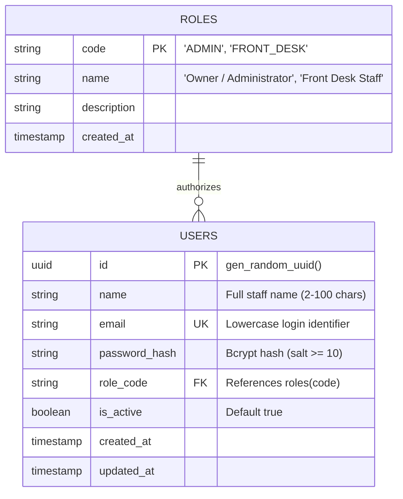
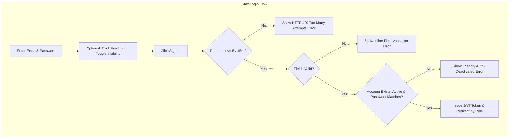

# Module 1: Staff Authentication & Role-Based Access Control (RBAC)

## 1. Module Overview
This module governs staff identity, secure email-based authentication, password security, rate-limiting protection, and role-based access control (RBAC) between the **Business Owner (`ADMIN`)** and **Front-Desk Staff (`FRONT_DESK`)**. It uses a dedicated reference table for **roles** where the **natural code (`code`) is the primary key and foreign key**, and **UUID (`gen_random_uuid()`)** for staff entity primary keys.

---

## 2. Database Schema Architecture



---

## 3. Features & Capabilities Breakdown

1. **Email-Based Authentication with Password Visibility Toggle:** Sign in using a registered email address and password, featuring an interactive eye-icon toggle (`type="password"` $\leftrightarrow$ `type="text"`).
2. **Reference-Driven RBAC (`roles.code`):** Role authorization decoupled into a `roles` reference table controlling both frontend route guards and backend API middleware (`ADMIN` vs. `FRONT_DESK`).
3. **Brute-Force Rate Limiting Defense:** Express middleware (`rateLimiter`) restricts `/api/v1/auth/login` and `/api/v1/auth/forgot-password` to 5 attempts per 15-minute sliding window per IP (`HTTP 429`).
4. **Staff Account CRUD (`StaffDrawer` — 540px) & Self-Lockout Guard:** Business owner creates, edits, and deactivates staff accounts inside a 540px slide-in drawer with unsaved-changes protection, while preventing self-deactivation or self-demotion.
5. **Owner-Assisted Password Recovery & Reset:** Interactive `"Forgot password?"` modal on the Login screen verifies registered accounts and shows owner recovery guidance; owners can reset any staff password via `ResetPasswordModal`.
6. **Active Screen Persistence & Strict Sign-Out:** Stores active navigation screen (`gym_active_screen`) in `localStorage` across refreshes and clears all session state immediately upon clicking `Log Out`.

---

## 4. User Stories, Field Validation Rules & Acceptance Criteria



---

### `US-AUTH-01`: Email-Based Login with Password Visibility Toggle & Rate Limiting
- **User Story:**  
  *As a gym owner or front-desk staff member, I want to sign in using my email and password—with the ability to toggle password visibility—so that I can verify my input and securely access my workspace.*

- **Field Validation Rules (`Login Form`):**
  | Field | Type | Constraints & Validation Rules | Exact Validation Error Message |
  | :--- | :--- | :--- | :--- |
  | `email` | `string` | **Required.** Trimmed, lowercase normalized, max `255` chars, must match standard email regex (`^[^\s@]+@[^\s@]+\.[^\s@]+$`). | *"Please enter a valid email address (e.g., name@gym.com)."* |
  | `password` | `string` | **Required.** Cannot be empty or whitespace-only on login submission. | *"Please enter your password."* |

- **Behavioral Acceptance Criteria (`US-AUTH-01`):**
  - **AC-01.1 (Form Layout):** The login screen displays inputs for `Email Address *` and `Password *` (both marked with a red required asterisk `*`), an interactive **eye icon** inside the password input, a `"Forgot password?"` button, and a `Sign In` submit button.
  - **AC-01.2 (Password Eye Toggle Behavior):** Clicking the **eye icon** toggles the password input `type` between `password` (masked dots) and `text` (plain text) without losing input focus or cursor position.
  - **AC-01.3 (Empty / Invalid Email Behavior):** Submitting an empty or malformed email prevents the API call, highlights the email border in red, and displays: *"Please enter a valid email address (e.g., name@gym.com)."*
  - **AC-01.4 (Empty Password Behavior):** Submitting a blank password prevents the API call, highlights the password border in red, and displays: *"Please enter your password."*
  - **AC-01.5 (Invalid Credentials Behavior):** If the email is not found or the `bcryptjs` password comparison fails (`HTTP 401`):
    - **Error Message:** *"Invalid email or password. Please verify your credentials."*
  - **AC-01.6 (Deactivated Account Behavior):** If the staff record has `is_active = false` (`HTTP 403`):
    - **Error Message:** *"This account has been deactivated. Please contact the gym owner."*
  - **AC-01.7 (Rate Limiting Behavior):** If more than 5 login requests occur within a 15-minute sliding window from the same IP (`HTTP 429`):
    - **Error Message:** *"Too many login attempts from this IP address. Please wait 15 minutes before trying again."*
  - **AC-01.8 (Role-Based Post-Login Redirect Behavior):** Upon successful authentication:
    - Users with `role_code = 'ADMIN'` are redirected to the **Owner Dashboard** (`/dashboard`).
    - Users with `role_code = 'FRONT_DESK'` are redirected directly to the **Fast Gym Sign-In Terminal** (`/check-in`).

---

### `US-AUTH-02`: Reference-Driven Role-Based Access Control (RBAC)
- **User Story:**  
  *As a business owner, I want system permissions strictly controlled by the `roles(code)` reference table so that front-desk staff can check members in and process memberships without accessing owner settings or voiding payments.*

- **Field Validation Rules (`Role Authorization`):**
  | Field | Type | Constraints & Validation Rules | Exact Validation Error Message |
  | :--- | :--- | :--- | :--- |
  | `role_code` | `string` | **Required.** Must match an existing primary key in `roles(code)`: `'ADMIN'` or `'FRONT_DESK'`. | *"Please select a valid staff role (Owner/Admin or Front Desk)."* |

- **Behavioral Acceptance Criteria (`US-AUTH-02`):**
  - **AC-02.1 (Reference Table Integrity):** The database `roles` table uses `code VARCHAR(30) PRIMARY KEY` seeded with `'ADMIN'` and `'FRONT_DESK'`.
  - **AC-02.2 (Front-Desk Navigation & UI Restrictions):** When logged in as `FRONT_DESK`:
    - Allowed screens: **Fast Check-In Terminal (Staff + Kiosk Launch)**, **Members & Subscriptions**, **Membership Plans (Read-Only View)**, and **Membership Payments & Receipts**.
    - Restricted screens/actions: **Owner Dashboard**, **Staff Management**, **Gym Settings**, **Create/Edit/Deactivate Membership Plans**, and **Void Payment** buttons are hidden or disabled in the UI.
  - **AC-02.3 (Frontend Route Guard Behavior):** If a `FRONT_DESK` user attempts to navigate to `/dashboard`, `/staff`, or `/settings`, the frontend route guard intercepts the navigation, redirects them to `/check-in`, and triggers a top-right warning toast: *"Access restricted: Only the Gym Owner can view that page."*
  - **AC-02.4 (Backend Middleware Enforcement):** Every administrative API route enforces `requireRole('ADMIN')`. Any unauthorized call returns `HTTP 403 Forbidden` with the JSON envelope:
    - **API Error Message:** *"Forbidden: You do not have permission to perform this action."*

---

### `US-AUTH-03`: Staff Account Management (`StaffDrawer`) & Password Reset (`ResetPasswordModal`)
- **User Story:**  
  *As a business owner, I want to create, update, reset passwords for, and deactivate staff accounts inside a 540px slide-in drawer so that employee access is always up to date.*

- **Field Validation Rules (`StaffDrawer` & `ResetPasswordModal`):**
  | Field | Type | Constraints & Validation Rules | Exact Validation Error Message |
  | :--- | :--- | :--- | :--- |
  | `name` | `string` | **Required.** Trimmed length between `2` and `100` characters. | *"Staff name must be between 2 and 100 characters."* |
  | `email` | `string` | **Required.** Valid email format, max `255` chars, unique (case-insensitive) in `users`. | *"Please enter a valid email address."* / *"A staff account with this email address already exists."* |
  | `role_code` | `string` | **Required.** Must be `'ADMIN'` or `'FRONT_DESK'`. | *"Please select a valid role for this staff member."* |
  | `password` | `string` | **Required on Create & Reset.** Minimum `8` characters, max `72` characters, must include at least 1 letter and 1 number. | *"Password must be at least 8 characters long and include both letters and numbers."* |
  | `is_active` | `boolean` | **Required.** Boolean (`true` or `false`). Cannot set `false` on own currently authenticated user ID. | *"You cannot deactivate or demote your own active owner account."* |

- **Behavioral Acceptance Criteria (`US-AUTH-03`):**
  - **AC-03.1 (Staff Table & In-Column Kebab Menu):** Navigating to `/staff` renders shimmer skeleton rows during loading, then displays `Staff Name`, `Email`, `Role Badge`, `Sign-Ins Processed`, and `Status Badge` (`ACTIVE` / `INACTIVE`) with an in-column Kebab menu (`⋮`) in the rightmost column containing: `Edit Details`, `Reset Password`, and `Deactivate / Activate`.
  - **AC-03.2 (540px Drawer & Unsaved Changes Guard Behavior):** Clicking `+ Add Staff` or `Edit Details` opens the `540px` slide-in `StaffDrawer` with a descriptive subtitle. If the user modifies any field and attempts to close the drawer (`Esc`, backdrop click, or `Cancel`), an **Unsaved Changes Guard Modal** prompts: *"You have unsaved changes. Are you sure you want to discard them?"*
  - **AC-03.3 (Duplicate Email Guard Behavior):** Attempting to create or update a staff member with an email already registered to another user returns `HTTP 409 Conflict` with: *"A staff account with this email address already exists."*
  - **AC-03.4 (Self-Lockout Prevention Behavior):** If the logged-in `ADMIN` attempts to set `is_active = false` or change `role_code` to `'FRONT_DESK'` on their own account, the backend rejects the request (`HTTP 400`) with: *"You cannot deactivate or demote your own active owner account."*
  - **AC-03.5 (Password Reset Behavior):** Clicking `Reset Password` in the Kebab menu opens `ResetPasswordModal` (with an eye-icon visibility toggle). Submitting a valid password ($\ge 8$ chars with letters and numbers) hashes the password with `bcryptjs` and displays a top-right success toast: *"Password updated successfully for {Name}."*

---

### `US-AUTH-04`: Forgot Password Assistance & Session Persistence
- **User Story:**  
  *As a staff member, I want a password assistance dialog if I forget my credentials, and I want my active screen preserved on refresh until I explicitly log out.*

- **Field Validation Rules (`ForgotPasswordModal`):**
  | Field | Type | Constraints & Validation Rules | Exact Validation Error Message |
  | :--- | :--- | :--- | :--- |
  | `email` | `string` | **Required.** Valid email format; must exist in `users`. | *"No staff account found for '{email}'. Please check the spelling or contact the gym owner."* |

- **Behavioral Acceptance Criteria (`US-AUTH-04`):**
  - **AC-04.1 (Forgot Password Lookup Behavior):** Submitting a registered staff email in `ForgotPasswordModal` verifies the account and displays the Gym Owner's contact information and instructions to have the owner reset the password via `/staff`.
  - **AC-04.2 (Active Screen Persistence Behavior):** While authenticated, refreshing the browser restores the exact active screen stored in `localStorage` (`gym_active_screen`). Unauthenticated visits strictly render the `Login` screen with zero flash of protected content.
  - **AC-04.3 (Strict Logout Behavior):** Clicking `Log Out` in the sidebar footer or top header immediately removes `gym_auth_token`, `gym_auth_user`, and `gym_active_screen` from `localStorage` and transitions to `Login`.

---

## 5. Database Schema Relational Specification

```sql
CREATE TABLE IF NOT EXISTS roles (
    code VARCHAR(30) PRIMARY KEY,
    name VARCHAR(50) NOT NULL,
    description TEXT,
    created_at TIMESTAMPTZ NOT NULL DEFAULT NOW()
);

INSERT INTO roles (code, name, description) VALUES
('ADMIN', 'Owner / Administrator', 'Full access to memberships, usage analytics, payments, staff, and gym settings'),
('FRONT_DESK', 'Front Desk Staff', 'Access to fast check-in terminal, kiosk mode, member registration, and membership payments')
ON CONFLICT (code) DO NOTHING;

CREATE TABLE IF NOT EXISTS users (
    id UUID PRIMARY KEY DEFAULT gen_random_uuid(),
    name VARCHAR(100) NOT NULL,
    email VARCHAR(255) UNIQUE NOT NULL,
    password_hash VARCHAR(255) NOT NULL,
    role_code VARCHAR(30) NOT NULL REFERENCES roles(code),
    is_active BOOLEAN NOT NULL DEFAULT TRUE,
    created_at TIMESTAMPTZ NOT NULL DEFAULT NOW(),
    updated_at TIMESTAMPTZ NOT NULL DEFAULT NOW()
);

CREATE INDEX IF NOT EXISTS idx_users_email ON users(email);
```
