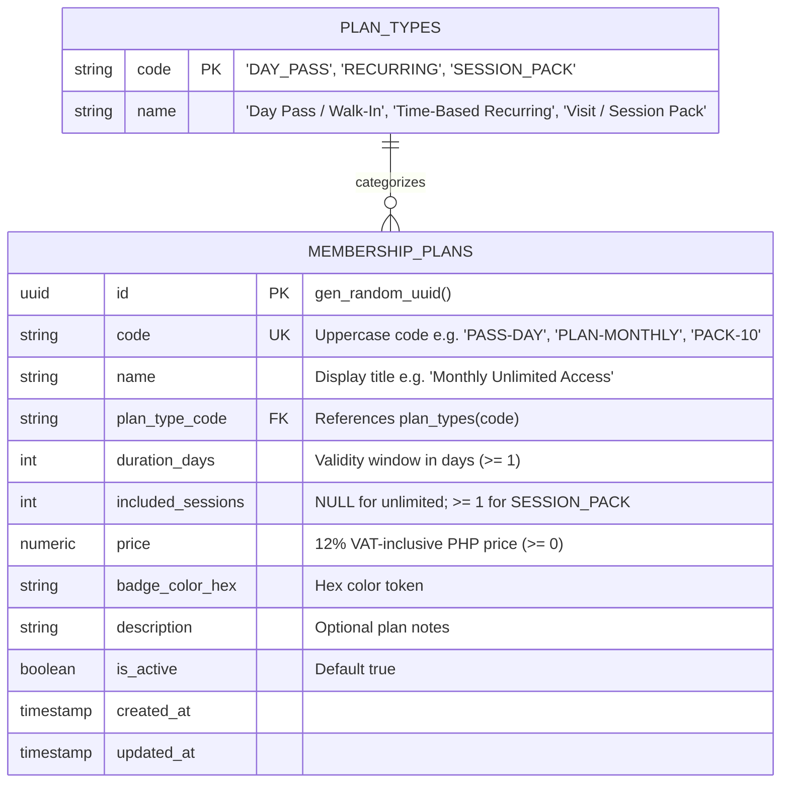
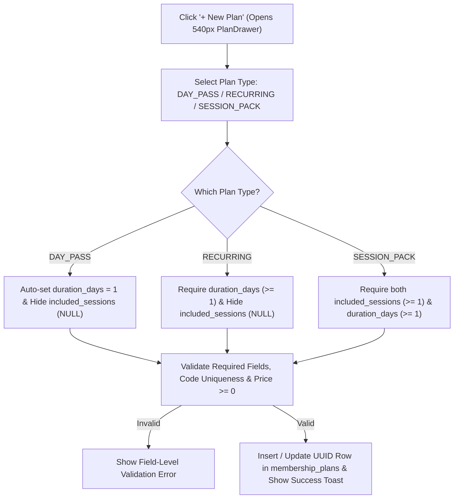

# Module 2: Membership Plans & Visit Packs

## 1. Module Overview
This module enables the business owner to create and manage the gym's catalog of **Time-Based Unlimited Plans** (`DAY_PASS`, `RECURRING`) and **Visit/Session Packs** (`SESSION_PACK`). All plan records use **UUID (`gen_random_uuid()`)** primary keys, while plan types use a natural string code reference table (`plan_types(code)`). All plan prices adhere to the **Philippine BIR 12% VAT-Inclusive** standard.

---

## 2. Database Schema Architecture



---

## 3. Features & Capabilities Breakdown

1. **Hybrid Plan Support (`DAY_PASS`, `RECURRING`, `SESSION_PACK`):**
   * `DAY_PASS`: Valid for 1 calendar day (`duration_days = 1`, `included_sessions = NULL`).
   * `RECURRING`: Unlimited gym sign-ins within a fixed duration window (e.g., 30, 90, 180, or 365 days; `included_sessions = NULL`).
   * `SESSION_PACK`: Fixed number of gym visits (e.g., 10 or 20 visits; `included_sessions >= 1`) that must be used within a validity window (`duration_days`, e.g., 90 days).
2. **Slide-In Plan Management (`PlanDrawer` — 540px):** Create, edit, duplicate, and deactivate plans inside a 540px slide-in drawer with dynamic conditional inputs based on `plan_type_code`.
3. **12% BIR VAT-Inclusive Pricing:** Configured price is the exact final PHP amount paid by the member at checkout.
4. **Historical Subscription Protection:** Editing a plan's price or duration only applies to future enrollments; plans linked to historical subscriptions cannot be hard-deleted (archived via `is_active = false`).

---

## 4. User Stories, Field Validation Rules & Acceptance Criteria



---

### `US-PLAN-01`: Create & Edit Time-Based Plans and Visit Packs (`PlanDrawer`)
- **User Story:**  
  *As a business owner, I want to create and configure Day Passes, Recurring Time-Based Plans, and Visit Packs with clear duration, visit quota, and VAT-inclusive price rules so that front-desk staff can enroll members accurately.*

- **Field Validation Rules (`PlanDrawer`):**
  | Field | Type | Constraints & Validation Rules | Exact Validation Error Message |
  | :--- | :--- | :--- | :--- |
  | `name` | `string` | **Required.** Trimmed length between `2` and `100` characters. | *"Plan name must be between 2 and 100 characters."* |
  | `code` | `string` | **Required.** Auto-uppercased, `3` to `40` characters, alphanumeric and hyphens only (`^[A-Z0-9-]+$`), unique in `membership_plans`. | *"Plan code must be 3–40 uppercase letters, numbers, or hyphens (e.g., PLAN-MONTHLY)."* / *"A membership plan with code '{code}' already exists."* |
  | `plan_type_code` | `string` | **Required.** Must exist in `plan_types(code)`: `'DAY_PASS'`, `'RECURRING'`, or `'SESSION_PACK'`. | *"Please select a valid plan type."* |
  | `duration_days` | `integer` | **Required.** Whole integer between `1` and `3650` (10 years). If `plan_type_code = 'DAY_PASS'`, locked to `1`. | *"Duration must be a whole number of days between 1 and 3,650."* |
  | `included_sessions` | `integer \| null` | **Conditionally Required.** If `plan_type_code = 'SESSION_PACK'`, required whole integer between `1` and `1000`. If `'DAY_PASS'` or `'RECURRING'`, must be `NULL`. | *"Please enter the number of included visits (1 to 1,000) for a Visit/Session Pack."* |
  | `price` | `numeric(10,2)` | **Required.** Numeric value between `0.00` and `999999.99`. | *"Please enter a valid price of ₱0.00 or greater."* |
  | `badge_color_hex` | `string` | **Required.** Valid 7-character hex color (`^#[0-9A-Fa-f]{6}$`), defaults to `'#2563EB'` (Royal Blue). | *"Please select a valid badge color."* |
  | `description` | `string \| null` | **Optional.** Max `500` characters. | *"Description cannot exceed 500 characters."* |

- **Behavioral Acceptance Criteria (`US-PLAN-01`):**
  - **AC-01.1 (Dynamic Form Field Behavior by Plan Type):**
    - Selecting `'DAY_PASS'` automatically sets `duration_days = 1` (read-only) and hides the `Included Visits` input (`included_sessions = null`).
    - Selecting `'RECURRING'` enables `Duration (Days) *` and hides `Included Visits` (`included_sessions = null`).
    - Selecting `'SESSION_PACK'` enables both `Included Visits *` (e.g., `10` visits) and `Validity Window (Days) *` (e.g., `90` days before unused visits expire).
  - **AC-01.2 (Dirty Drawer Guard Behavior):** If the owner modifies any field in `PlanDrawer` and clicks outside, presses `Esc`, or clicks `Cancel`, the **Unsaved Changes Guard Modal** prompts before closing.
  - **AC-01.3 (Duplicate Code Prevention Behavior):** Submitting a `code` that already exists returns `HTTP 409 Conflict` and displays: *"A membership plan with code '{code}' already exists."*
  - **AC-01.4 (VAT-Inclusive Preview Behavior):** Entering a `price` (e.g., `₱1,500.00`) displays a helper caption below the price field showing the 12% BIR VAT-inclusive breakdown: *"Includes ₱160.71 (12% VAT) • Net Base: ₱1,339.29"*.

---

### `US-PLAN-02`: View, Filter, Duplicate & Deactivate Membership Plans
- **User Story:**  
  *As a business owner, I want to filter plans by type, duplicate existing plans to create seasonal promos quickly, and deactivate discontinued plans without breaking historical member subscriptions.*

- **Behavioral Acceptance Criteria (`US-PLAN-02`):**
  - **AC-02.1 (Table & Card Display with Shimmer Skeletons):** While loading, the Plans screen renders shimmer skeleton loaders. Once loaded, each plan displays its `Plan Code`, `Name`, `Type Badge` (`DAY_PASS`, `RECURRING`, `SESSION_PACK`), `Validity / Visits Summary` (e.g., *"30 Days • Unlimited Visits"* or *"10 Visits • Valid 90 Days"*), `Price (₱)` in tabular monospace font, `Active Status Badge`, and an in-column Kebab menu (`⋮`).
  - **AC-02.2 (Duplicate Plan Behavior):** Clicking `Duplicate` in a plan's Kebab menu opens `PlanDrawer` pre-filled with the selected plan's values, appending `-COPY` to `code` and `(Copy)` to `name` so the owner can save a new variation immediately.
  - **AC-02.3 (Historical Price Isolation & Safe Deactivation Behavior):**
    - Updating a plan's `price` or `duration_days` never alters `plan_price_at_purchase`, `end_date`, or `remaining_sessions` on existing `member_subscriptions`.
    - Clicking `Deactivate` in the Kebab menu sets `is_active = false`, hiding the plan from new checkout selections while keeping it intact for existing members and historical reports.

---

## 5. Database Schema Relational Specification

```sql
CREATE TABLE IF NOT EXISTS plan_types (
    code VARCHAR(30) PRIMARY KEY,
    name VARCHAR(50) NOT NULL
);

INSERT INTO plan_types (code, name) VALUES
('DAY_PASS', 'Day Pass / Walk-In'),
('RECURRING', 'Time-Based Recurring Plan'),
('SESSION_PACK', 'Visit / Session Pack')
ON CONFLICT (code) DO NOTHING;

CREATE TABLE IF NOT EXISTS membership_plans (
    id UUID PRIMARY KEY DEFAULT gen_random_uuid(),
    code VARCHAR(40) UNIQUE NOT NULL,
    name VARCHAR(100) NOT NULL,
    plan_type_code VARCHAR(30) NOT NULL REFERENCES plan_types(code),
    duration_days INT NOT NULL CHECK (duration_days BETWEEN 1 AND 3650),
    included_sessions INT CHECK (
        (plan_type_code = 'SESSION_PACK' AND included_sessions BETWEEN 1 AND 1000) OR
        (plan_type_code IN ('DAY_PASS', 'RECURRING') AND included_sessions IS NULL)
    ),
    price NUMERIC(10, 2) NOT NULL CHECK (price >= 0),
    badge_color_hex VARCHAR(20) NOT NULL DEFAULT '#2563EB',
    description TEXT,
    is_active BOOLEAN NOT NULL DEFAULT TRUE,
    created_at TIMESTAMPTZ NOT NULL DEFAULT NOW(),
    updated_at TIMESTAMPTZ NOT NULL DEFAULT NOW()
);

CREATE INDEX IF NOT EXISTS idx_membership_plans_active ON membership_plans(is_active, plan_type_code);
```
