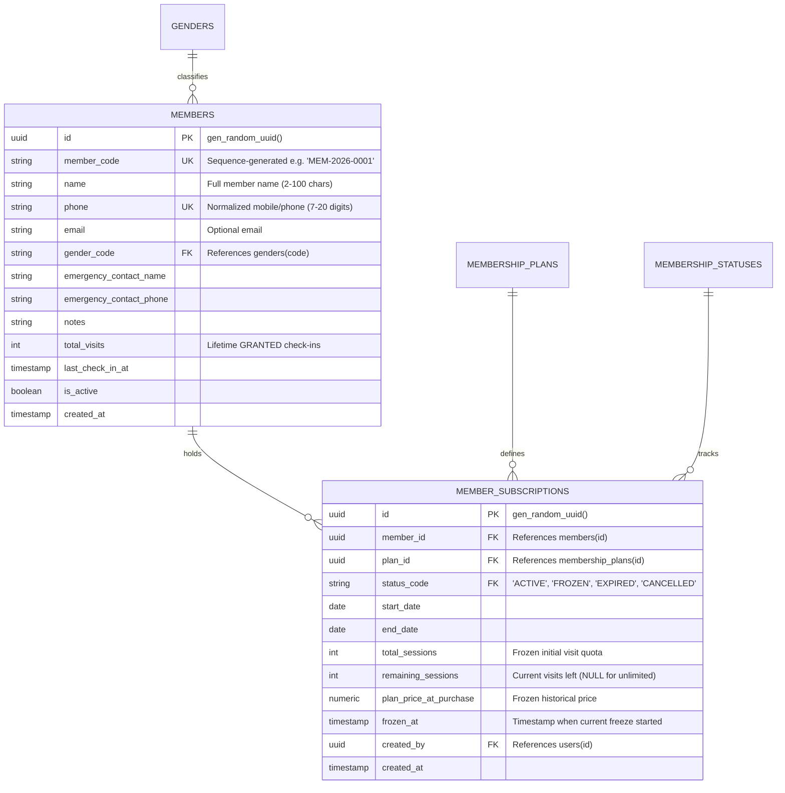
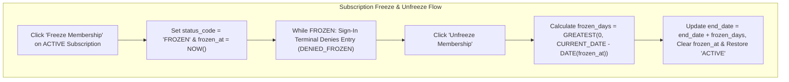

# Module 3: Member Directory, QR Pass Card & Subscriptions

## 1. Module Overview
This module manages gym member registration, unique concurrency-safe **Member Codes (`MEM-YYYY-XXXX`)**, printable/scannable **Member QR Pass Cards**, active subscription tracking (`ACTIVE`, `FROZEN`, `EXPIRED`, `CANCELLED`), temporary membership freezes, and date-stacked renewals. All domain and transactional entities (`members`, `member_subscriptions`) use **UUID (`gen_random_uuid()`)** primary keys, while lookup tables (`genders`, `membership_statuses`) use natural `code` primary keys.

---

## 2. Database Schema Architecture



---

## 3. Features & Capabilities Breakdown

1. **Concurrency-Safe Member Code Generation (`MEM-YYYY-XXXX`):** Automatically generated on member creation via PostgreSQL sequence `nextval('member_code_seq')`.
2. **Slide-In Member Profile CRUD (`MemberDrawer` — 540px):** Captures member identity, normalized phone number (used for fast kiosk sign-in), gender (`genders.code`), emergency contact details, and notes.
3. **Instant Member QR Pass Card (`MemberPassModal`):** Generates a high-contrast vector SVG QR Code encoding `member_code` (`MEM-YYYY-XXXX`) that can be printed or saved to the member's phone for 1-second kiosk check-in.
4. **Subscription Status & Expiration Engine:** Automatically tracks `start_date`, `end_date`, and `remaining_sessions`, displaying clear visual badges (`ACTIVE`, `EXPIRING SOON`, `FROZEN`, `EXPIRED`, `NO PLAN`).
5. **Freeze & Unfreeze Membership Workflow:** Allows pausing an active recurring membership (`status_code = 'FROZEN'`) and automatically extends `end_date` by the exact number of frozen days upon unfreezing.
6. **Date-Stacked Renewal Protection:** Renewing an active plan automatically stacks the new validity window onto the end of the current plan (`current_end_date + 1 day`) so members never lose remaining paid days.

---

## 4. User Stories, Field Validation Rules & Acceptance Criteria



---

### `US-MEM-01`: Register & Edit Gym Members (`MemberDrawer`)
- **User Story:**  
  *As a front-desk staff member or owner, I want to register new gym members with a unique phone number and auto-generated Member Code so that we can manage their subscriptions and enable fast gym sign-in.*

- **Field Validation Rules (`MemberDrawer`):**
  | Field | Type | Constraints & Validation Rules | Exact Validation Error Message |
  | :--- | :--- | :--- | :--- |
  | `name` | `string` | **Required.** Trimmed length between `2` and `100` characters. | *"Member name must be between 2 and 100 characters."* |
  | `phone` | `string` | **Required.** Digits, spaces, `+`, and `-` allowed; must contain `7` to `15` digits (`^[0-9+\-\s()]{7,20}$`), unique across `members`. | *"Please enter a valid phone number (7 to 15 digits, e.g., 09171234567)."* / *"A member with phone number '{phone}' is already registered."* |
  | `email` | `string \| null` | **Optional.** If provided, max `255` chars and must match valid email regex. | *"Please enter a valid email address or leave it blank."* |
  | `gender_code` | `string` | **Required.** Must match a valid `code` in `genders`: `'MALE'`, `'FEMALE'`, `'NON_BINARY'`, or `'PREFER_NOT_TO_SAY'`. | *"Please select a gender option."* |
  | `emergency_contact_name` | `string \| null` | **Optional.** Max `100` characters. | *"Emergency contact name cannot exceed 100 characters."* |
  | `emergency_contact_phone` | `string \| null` | **Optional.** If provided, must contain `7` to `15` digits. | *"Please enter a valid emergency contact phone number."* |
  | `notes` | `string \| null` | **Optional.** Max `500` characters (e.g., medical notes or locker preference). | *"Notes cannot exceed 500 characters."* |

- **Behavioral Acceptance Criteria (`US-MEM-01`):**
  - **AC-01.1 (Atomic Member Code Generation Behavior):** Saving a new member in `MemberDrawer` automatically generates the next sequential `member_code` (`MEM-YYYY-XXXX`) via PostgreSQL `nextval('member_code_seq')` and displays a top-right success toast: *"Member {Name} ({member_code}) registered successfully."*
  - **AC-01.2 (Duplicate Phone Number Guard Behavior):** Submitting a phone number that already belongs to an existing member returns `HTTP 409 Conflict` and displays: *"A member with phone number '{phone}' is already registered."*
  - **AC-01.3 (Branded Vector Avatar Fallback Behavior):** Member rows render a clean athletic SVG vector avatar in `SvgIcon` (never emojis or broken image icons).
  - **AC-01.4 (Immediate Plan Enrollment Shortcut Behavior):** After creating a member, the user can click `"Save & Enroll in Plan"`, which saves the member and immediately opens `PaymentModal` with that member pre-selected.

---

### `US-MEM-02`: View Member QR Pass Card (`MemberPassModal`)
- **User Story:**  
  *As a gym member or front-desk staff, I want to view or print a Member Pass Card containing the member's unique code and QR pass so that the member can sign in at the kiosk in 1 second.*

- **Behavioral Acceptance Criteria (`US-MEM-02`):**
  - **AC-02.1 (QR Pass Modal Content):** Clicking `View Member Pass` in a member's Kebab menu (`⋮`) opens `MemberPassModal` showing: Gym Name, Member Full Name, `member_code` (`MEM-YYYY-XXXX`) in large monospace text, current subscription status & expiry date, and a crisp SVG QR code encoding `member_code`.
  - **AC-02.2 (Print / Save Pass Behavior):** Clicking `Print Member Pass` uses `@media print` isolation to print only the badge card cleanly.

---

### `US-MEM-03`: Manage Subscriptions — Freeze, Unfreeze & Cancel
- **User Story:**  
  *As a business owner or front-desk staff, I want to freeze an active membership when a member travels or recovers from injury, and unfreeze it later with their expiration date automatically extended by the frozen days.*

- **Field Validation Rules (`Freeze / Unfreeze / Cancel Subscription`):**
  | Field / State | Type | Constraints & Validation Rules | Exact Validation Error Message |
  | :--- | :--- | :--- | :--- |
  | `subscription_id` | `UUID` | **Required.** Must reference an existing `member_subscriptions(id)`. | *"Subscription record not found."* |
  | `Freeze Action` | `state` | Subscription must currently have `status_code = 'ACTIVE'` and `plan_type_code != 'DAY_PASS'`. | *"Only active recurring memberships or visit packs can be frozen."* |
  | `Unfreeze Action` | `state` | Subscription must currently have `status_code = 'FROZEN'`. | *"Only a frozen membership can be unfrozen."* |

- **Behavioral Acceptance Criteria (`US-MEM-03`):**
  - **AC-03.1 (Freeze Subscription Behavior):** Clicking `Freeze Plan` in the member's Kebab menu transitions `status_code` from `'ACTIVE'` to `'FROZEN'`, sets `frozen_at = NOW()`, and displays: *"Membership for {Name} is now frozen. Check-in is paused until unfrozen."*
  - **AC-03.2 (Unfreeze Date-Extension Math Behavior):** Clicking `Unfreeze Plan` on a `'FROZEN'` subscription computes `frozen_days = GREATEST(0, CURRENT_DATE - DATE(frozen_at))`, adds `frozen_days` to `end_date`, clears `frozen_at = NULL`, restores `status_code = 'ACTIVE'`, and displays: *"Membership unfrozen! Expiration date extended by {frozen_days} day(s) to {new_end_date}."*
  - **AC-03.3 (Automatic Expiration Transition Behavior):** Whenever a subscription is queried or evaluated at sign-in, if `status_code = 'ACTIVE'` and (`CURRENT_DATE > end_date` OR (`remaining_sessions IS NOT NULL AND remaining_sessions <= 0`)), the system transitions `status_code` to `'EXPIRED'`.

---

## 5. Database Schema Relational Specification

```sql
CREATE SEQUENCE IF NOT EXISTS member_code_seq START 1;

CREATE TABLE IF NOT EXISTS genders (
    code VARCHAR(30) PRIMARY KEY,
    name VARCHAR(50) NOT NULL
);

INSERT INTO genders (code, name) VALUES
('MALE', 'Male'),
('FEMALE', 'Female'),
('NON_BINARY', 'Non-Binary'),
('PREFER_NOT_TO_SAY', 'Prefer Not to Say')
ON CONFLICT (code) DO NOTHING;

CREATE TABLE IF NOT EXISTS membership_statuses (
    code VARCHAR(30) PRIMARY KEY,
    name VARCHAR(50) NOT NULL
);

INSERT INTO membership_statuses (code, name) VALUES
('ACTIVE', 'Active'),
('FROZEN', 'Frozen / On Hold'),
('EXPIRED', 'Expired'),
('CANCELLED', 'Cancelled / Voided')
ON CONFLICT (code) DO NOTHING;

CREATE TABLE IF NOT EXISTS members (
    id UUID PRIMARY KEY DEFAULT gen_random_uuid(),
    member_code VARCHAR(30) UNIQUE NOT NULL,
    name VARCHAR(100) NOT NULL,
    phone VARCHAR(30) UNIQUE NOT NULL,
    email VARCHAR(255),
    gender_code VARCHAR(30) NOT NULL REFERENCES genders(code),
    emergency_contact_name VARCHAR(100),
    emergency_contact_phone VARCHAR(30),
    notes TEXT,
    total_visits INT NOT NULL DEFAULT 0 CHECK (total_visits >= 0),
    last_check_in_at TIMESTAMPTZ,
    is_active BOOLEAN NOT NULL DEFAULT TRUE,
    created_at TIMESTAMPTZ NOT NULL DEFAULT NOW(),
    updated_at TIMESTAMPTZ NOT NULL DEFAULT NOW()
);

CREATE TABLE IF NOT EXISTS member_subscriptions (
    id UUID PRIMARY KEY DEFAULT gen_random_uuid(),
    member_id UUID NOT NULL REFERENCES members(id),
    plan_id UUID NOT NULL REFERENCES membership_plans(id),
    status_code VARCHAR(30) NOT NULL REFERENCES membership_statuses(code),
    start_date DATE NOT NULL,
    end_date DATE NOT NULL CHECK (end_date >= start_date),
    total_sessions INT,
    remaining_sessions INT CHECK (remaining_sessions IS NULL OR remaining_sessions >= 0),
    plan_price_at_purchase NUMERIC(10, 2) NOT NULL CHECK (plan_price_at_purchase >= 0),
    frozen_at TIMESTAMPTZ,
    created_by UUID REFERENCES users(id),
    created_at TIMESTAMPTZ NOT NULL DEFAULT NOW(),
    updated_at TIMESTAMPTZ NOT NULL DEFAULT NOW()
);

CREATE INDEX IF NOT EXISTS idx_members_phone ON members(phone);
CREATE INDEX IF NOT EXISTS idx_members_code ON members(member_code);
CREATE INDEX IF NOT EXISTS idx_subscriptions_member_status ON member_subscriptions(member_id, status_code, end_date DESC);
```
