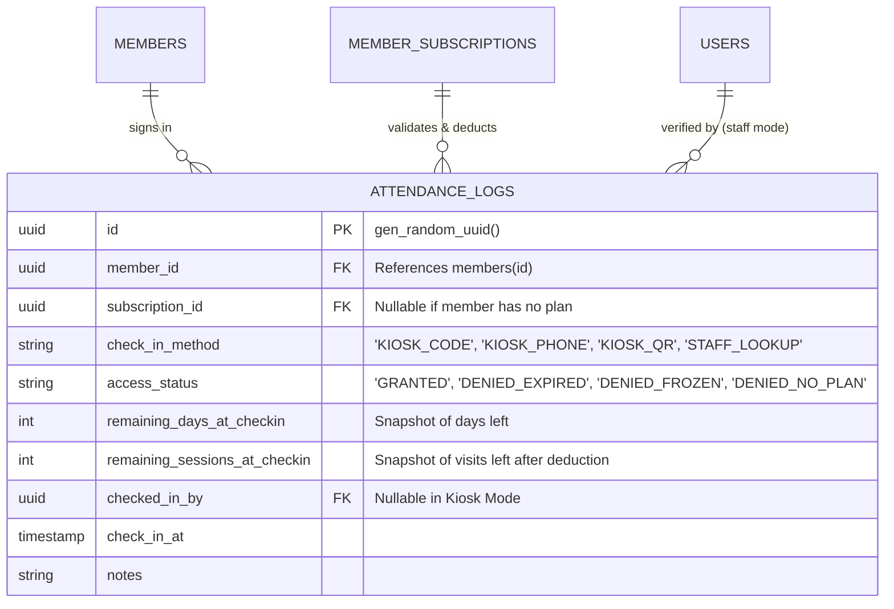
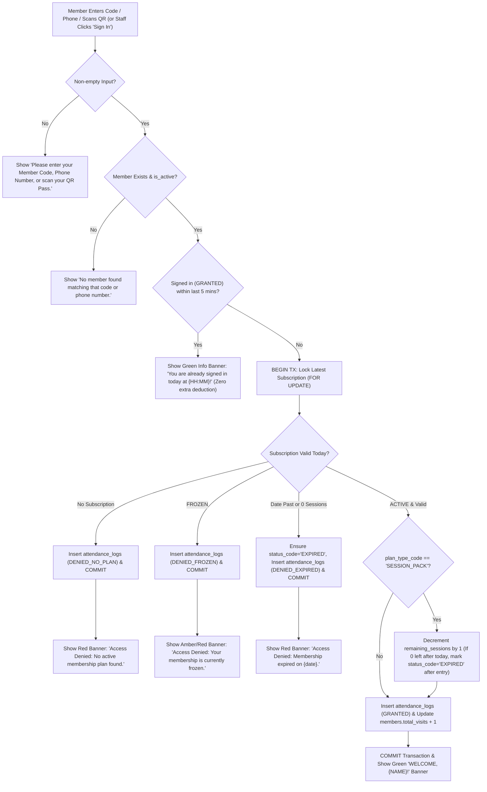

# Module 4: Fast Gym Sign-In Terminal & Usage Tracker

## 1. Module Overview
This module directly solves the **Member Fast Sign-In** and **Owner Usage Tracking** requirements. It provides a dual-mode check-in experience:
1. **Self-Service Kiosk Mode (Member-Facing Fullscreen View):** Members type their **Member Code (`MEM-2026-0001` or `0001`)**, type their **Phone Number (`0917...`)**, or scan their **QR Pass** to sign in within 1–2 seconds.
2. **Front-Desk Staff Lookup Mode:** Receptionists or the owner search by partial **Name**, **Phone Number**, or **Member Code** to sign a member in, view today's live usage feed, or renew an expired membership in 1 click.

Every sign-in attempt executes inside an ACID transaction (`BEGIN ... COMMIT` with `FOR UPDATE` row locking on the member's subscription) and writes an immutable entry to `attendance_logs` (`UUID` primary key).

---

## 2. Database Schema Architecture



---

## 3. Features & Capabilities Breakdown

1. **Instant Dual-Mode Sign-In (Kiosk Self-Sign-In + Staff Search):**
   * Accepts exact `member_code` (`MEM-2026-0001`), numeric suffix (`0001`), exact `phone` (`09171234567`), or QR scan in Kiosk Mode.
   * Accepts partial name, phone, or code search with debounced instant matching in Staff Mode.
2. **5-Minute Duplicate Sign-In Cooldown Guard:** Prevents accidental double taps or double QR scans within 5 minutes from deducting two visits from a `SESSION_PACK` or creating duplicate attendance logs.
3. **ACID Session Pack Deduction (`FOR UPDATE`):** Locks the member's active subscription row, decrements `remaining_sessions` by 1, increments `members.total_visits`, updates `members.last_check_in_at`, and records the attendance row atomically.
4. **High-Contrast Visual Status Banners (`GRANTED`, `EXPIRING SOON`, `DENIED`):**
   * **Green (`ACCESS GRANTED`):** Shows member name, plan title, and remaining days/visits.
   * **Amber Sub-Alert (`EXPIRING SOON`):** Highlights when $\le 3$ days or $\le 2$ visits remain.
   * **Red (`ACCESS DENIED`):** Clearly states whether the membership is `EXPIRED`, `FROZEN`, or `NO ACTIVE PLAN`, with a 1-click **"Renew / Buy Day Pass"** button in Staff Mode.
5. **Kiosk Auto-Reset & Backoffice Lock Protection:** Kiosk result banners auto-clear after 4 seconds and re-focus the input for the next member; exiting Kiosk Mode back to Staff Backoffice requires entering the logged-in staff member's password.

---

## 4. User Stories, Field Validation Rules & Acceptance Criteria



---

### `US-CHK-01`: Kiosk Self-Sign-In by Member Code, Phone Number, or QR Pass
- **User Story:**  
  *As a gym member arriving at the gym, I want to type my Member Code or Phone Number (or scan my QR Pass) on the front-desk kiosk screen so that I can sign in within 2 seconds and start my workout.*

- **Field Validation Rules (`Kiosk Sign-In Input`):**
  | Field | Type | Constraints & Validation Rules | Exact Validation Error Message |
  | :--- | :--- | :--- | :--- |
  | `identifier` | `string` | **Required.** Trimmed length between `1` and `50` characters. Matches exact `member_code` (case-insensitive, e.g., `MEM-2026-0001`), numeric suffix padded to 4 digits (e.g., `1` or `0001` $\to$ `MEM-YYYY-0001`), or exact normalized `phone` (e.g., `09171234567`). | *"Please enter your Member Code, Phone Number, or scan your QR Pass."* / *"Member not found. Please check your Member Code or Phone Number, or ask the Front Desk for assistance."* |
  | `check_in_method` | `string` | **Required.** Must be one of `'KIOSK_CODE'`, `'KIOSK_PHONE'`, `'KIOSK_QR'`, or `'STAFF_LOOKUP'`. | *"Invalid check-in method."* |

- **Behavioral Acceptance Criteria (`US-CHK-01`):**
  - **AC-01.1 (Auto-Focused Kiosk Input & Instant Submit Behavior):** In Kiosk Mode, the sign-in input is automatically focused at all times. Pressing `Enter` (or scanning a QR code with a barcode/QR scanner that sends `Enter`) immediately submits the sign-in request.
  - **AC-01.2 (Access Granted Behavior — Recurring / Day Pass):** If the member has an `'ACTIVE'` time-based subscription (`CURRENT_DATE BETWEEN start_date AND end_date`):
    - Inserts an `attendance_logs` row with `access_status = 'GRANTED'` and `remaining_days_at_checkin = (end_date - CURRENT_DATE)`.
    - Increments `members.total_visits` by `1` and updates `members.last_check_in_at = NOW()`.
    - Displays a large **Green Welcome Banner**: *"ACCESS GRANTED — Welcome back, {Member Name}! ({Plan Name} • {X} day(s) remaining)"*.
  - **AC-01.3 (Access Granted & Atomic Deduction Behavior — Visit/Session Pack):** If the member has an `'ACTIVE'` `SESSION_PACK` with `remaining_sessions >= 1` and `CURRENT_DATE <= end_date`:
    - Locks the subscription row (`FOR UPDATE`), decrements `remaining_sessions = remaining_sessions - 1`, and snapshots the new `remaining_sessions_at_checkin`.
    - If `remaining_sessions` reaches `0` after this deduction, the current check-in is still `'GRANTED'` for today's visit, and the subscription's `status_code` transitions to `'EXPIRED'` so future check-ins require a renewal.
    - Displays the **Green Welcome Banner**: *"ACCESS GRANTED — Welcome back, {Member Name}! (1 visit deducted • {remaining_sessions} visit(s) left)"*.
  - **AC-01.4 (5-Minute Duplicate Sign-In Cooldown Behavior):** If the same member already has a `'GRANTED'` row in `attendance_logs` within the last **5 minutes**:
    - The system **does not** insert a duplicate row and **does not** deduct another session.
    - Displays an informational green card: *"You are already signed in today at {HH:MM AM/PM}, {Member Name}! Enjoy your workout."*
  - **AC-01.5 (Expiring Soon Warning Badge Behavior):** When access is `'GRANTED'` and `remaining_days_at_checkin <= 3` or `remaining_sessions_at_checkin <= 2`, an amber warning pill appears inside the welcome card: *"Reminder: Only {X} day(s)/visit(s) left on your membership!"*
  - **AC-01.6 (Access Denied Behavior — Expired / Frozen / No Plan):**
    - **Expired:** Logs `access_status = 'DENIED_EXPIRED'` and displays a **Red Alert Banner**: *"ACCESS DENIED — Your membership expired on {end_date}. Please see the Front Desk to renew."*
    - **Frozen:** Logs `access_status = 'DENIED_FROZEN'` and displays an **Amber/Red Alert Banner**: *"ACCESS DENIED — Your membership is currently frozen. Please ask the Front Desk to unfreeze your plan."*
    - **No Plan:** Logs `access_status = 'DENIED_NO_PLAN'` and displays a **Red Alert Banner**: *"ACCESS DENIED — No active membership found for {Member Name}. Please see the Front Desk to purchase a plan or Day Pass."*
  - **AC-01.7 (4-Second Auto-Reset Behavior):** After displaying any result banner in Kiosk Mode, a 4-second countdown bar resets the screen back to the clean prompt and clears/re-focuses the input field.

---

### `US-CHK-02`: Front-Desk Staff Lookup, Kiosk Lock & Live Usage Feed
- **User Story:**  
  *As a front-desk staff member or owner, I want to search members by name, phone, or code to sign them in, view today's live check-in feed, and require a staff password when exiting Kiosk Mode so members cannot tamper with the backoffice.*

- **Field Validation Rules (`Exit Kiosk Password Guard` & `Usage Feed Filters`):**
  | Field | Type | Constraints & Validation Rules | Exact Validation Error Message |
  | :--- | :--- | :--- | :--- |
  | `staff_password` | `string` | **Required to Exit Kiosk Mode.** Must match the logged-in staff user's password hash. | *"Incorrect staff password. Kiosk mode remains locked."* |
  | `start_date` / `end_date` | `date` | **Optional Date Filter.** Valid ISO date (`YYYY-MM-DD`); `end_date >= start_date`. | *"End date cannot be earlier than start date."* |

- **Behavioral Acceptance Criteria (`US-CHK-02`):**
  - **AC-02.1 (Staff Live Search & 1-Click Action Behavior):** Typing $\ge 2$ characters in the Staff Check-In search bar displays matching members with their `Member Code`, `Phone`, `Plan Status Badge`, and either a green **`Sign In`** button (if `ACTIVE`), an amber **`Unfreeze`** button (if `FROZEN`), or a primary **`Renew / Buy Pass`** button (if `EXPIRED` or `NO PLAN`).
  - **AC-02.2 (Kiosk Exit Security Guard Behavior):** Clicking `"Launch Fullscreen Kiosk"` hides the sidebar and top navigation. Clicking `"Exit Kiosk"` opens a compact password verification modal; entering an invalid password blocks exit with: *"Incorrect staff password. Kiosk mode remains locked."*
  - **AC-02.3 (Live Usage Feed & Date-Filtered Attendance Ledger):** In Staff Mode, the lower table displays paginated `attendance_logs` showing `Timestamp`, `Member Name & Code`, `Plan Name`, `Method Badge` (`KIOSK` / `STAFF`), `Access Status Badge` (`GRANTED` / `DENIED`), and `Remaining Balance`, filterable by date range and status.

---

## 5. Database Schema Relational Specification

```sql
CREATE TABLE IF NOT EXISTS attendance_logs (
    id UUID PRIMARY KEY DEFAULT gen_random_uuid(),
    member_id UUID NOT NULL REFERENCES members(id),
    subscription_id UUID REFERENCES member_subscriptions(id),
    check_in_method VARCHAR(20) NOT NULL CHECK (
        check_in_method IN ('KIOSK_CODE', 'KIOSK_PHONE', 'KIOSK_QR', 'STAFF_LOOKUP')
    ),
    access_status VARCHAR(30) NOT NULL CHECK (
        access_status IN ('GRANTED', 'DENIED_EXPIRED', 'DENIED_FROZEN', 'DENIED_NO_PLAN')
    ),
    remaining_days_at_checkin INT,
    remaining_sessions_at_checkin INT,
    checked_in_by UUID REFERENCES users(id),
    check_in_at TIMESTAMPTZ NOT NULL DEFAULT NOW(),
    notes TEXT
);

CREATE INDEX IF NOT EXISTS idx_attendance_member_time ON attendance_logs(member_id, check_in_at DESC);
CREATE INDEX IF NOT EXISTS idx_attendance_time_status ON attendance_logs(check_in_at DESC, access_status);
```
