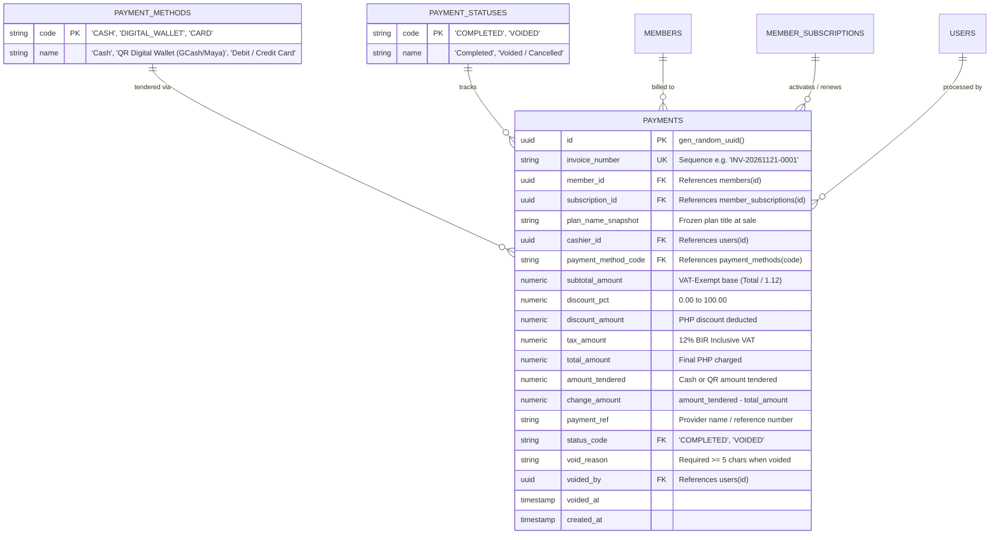
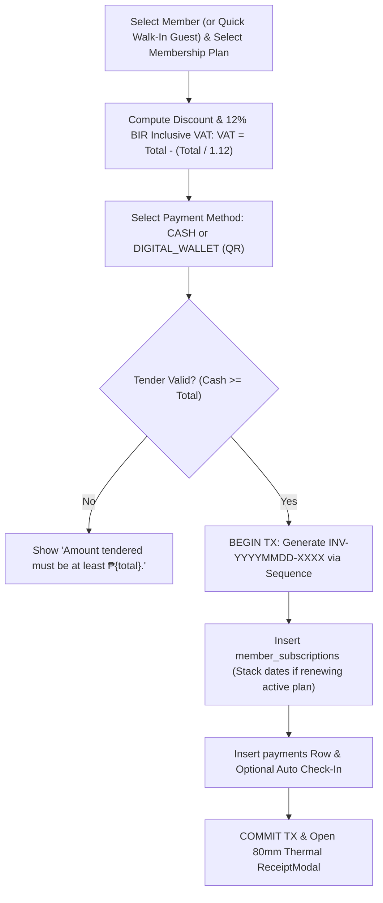

# Module 5: Membership Payments, Billing & 80mm Thermal Receipts

## 1. Module Overview
This module handles membership sales, renewals, and walk-in Day Pass checkouts. In a single ACID database transaction (`BEGIN ... COMMIT`), it records the payment in `payments` (`UUID` primary key), generates a concurrency-safe invoice number (`INV-YYYYMMDD-XXXX`), freezes the historical plan price, creates or extends the member's subscription in `member_subscriptions`, computes the **Philippine BIR 12% VAT-inclusive** breakdown, and opens an **80mm ESC/POS Thermal Receipt** (`ReceiptModal`) complete with the member's scannable QR Pass.

---

## 2. Database Schema Architecture



---

## 3. Features & Capabilities Breakdown

1. **Atomic Membership Enrollment & Payment Transaction:**
   * Generates `INV-YYYYMMDD-XXXX` via PostgreSQL sequence `nextval('invoice_number_seq')`.
   * Creates the `member_subscriptions` record with frozen `plan_price_at_purchase`, calculated `start_date` and `end_date` (stacking onto any existing active subscription's `end_date + 1 day`), and `remaining_sessions`.
   * Inserts the `payments` record with frozen `plan_name_snapshot` and 12% BIR VAT-inclusive math.
2. **1-Step "Quick Walk-In Day Pass" Enrollment:** Allows front-desk staff to enter a walk-in guest's `Name` and `Phone Number` inline inside the checkout modal, automatically registering the member, activating their 1-day pass, logging their immediate `'GRANTED'` gym sign-in, and printing their receipt in one click.
3. **Tactile Payment Modal (`PaymentModal`):**
   * **Cash Quick Bills:** **Exact**, **₱100**, **₱200**, **₱500**, **₱1,000** with live change calculation.
   * **Digital Wallet (QR):** 1-tap switching across uploaded gym QR codes (*GCash, Maya*) with fullscreen counter zoom.
   * **Preset Discount Pills:** 1-tap selection of configured discount tiers (e.g., *Student 10%*, *Senior/PWD 20%*).
4. **80mm Thermal Receipt with Embedded Member QR Pass (`ReceiptModal`):** Displays itemized 12% VAT-inclusive totals, membership validity dates, and the member's scannable QR code at the bottom of the thermal receipt (`@media print` isolated).
5. **Owner-Only Payment Void & Subscription Cancellation (`ConfirmVoidModal`):** Restricted to `ADMIN` with a mandatory audit reason ($\ge 5$ chars); atomically marks the payment `'VOIDED'` and the linked subscription `'CANCELLED'`.

---

## 4. User Stories, Field Validation Rules & Acceptance Criteria



---

### `US-PAY-01`: Process Membership Payment & Activate Subscription (`PaymentModal`)
- **User Story:**  
  *As a front-desk staff member or owner, I want to select a member and a membership plan, apply any eligible discount, collect Cash or QR Digital Wallet payment, and activate their membership in a single transaction.*

- **Field Validation Rules (`PaymentModal`):**
  | Field | Type | Constraints & Validation Rules | Exact Validation Error Message |
  | :--- | :--- | :--- | :--- |
  | `member_id` (or Walk-In `name` + `phone`) | `UUID` or `object` | **Required.** Must either select an existing active member `UUID` or provide a valid new walk-in `name` (2–100 chars) and unique `phone` (7–15 digits). | *"Please select a member or enter walk-in member details before completing payment."* |
  | `plan_id` | `UUID` | **Required.** Must reference an active plan (`is_active = true`) in `membership_plans`. | *"Please select an active membership plan."* |
  | `payment_method_code` | `string` | **Required.** Must exist in `payment_methods(code)`: `'CASH'` or `'DIGITAL_WALLET'` (`'CARD'` disabled with `"Coming Soon"` badge unless enabled). | *"Please select a valid payment method."* |
  | `discount_pct` | `numeric(5,2)` | **Optional.** Between `0.00` and `100.00` (defaults to `0.00`). | *"Discount percentage must be between 0% and 100%."* |
  | `amount_tendered` | `numeric(12,2)` | **Required.** Must be $\ge \text{total\_amount}$ up to `999999.99`. For `'DIGITAL_WALLET'`, auto-locks to exact `total_amount`. | *"Amount tendered (₱{tendered}) cannot be less than the total payable (₱{total})."* |
  | `payment_ref` | `string \| null` | **Optional / Recommended for QR.** Max `100` chars (auto-prefixed with selected QR provider name, e.g., `'GCash'`). | *"Payment reference cannot exceed 100 characters."* |
  | `auto_check_in` | `boolean` | **Optional.** Boolean toggle (default `true` for `DAY_PASS`, configurable for other plans) to automatically log an immediate `'GRANTED'` sign-in upon payment. | N/A |

- **Behavioral Acceptance Criteria (`US-PAY-01`):**
  - **AC-01.1 (12% BIR VAT-Inclusive Calculation Behavior):** Given a plan with price $P$ and discount percentage $D\%$:
    - $\text{Discount Amount} = \text{round}(P \times (D / 100), 2)$
    - $\text{Total Payable} = P - \text{Discount Amount}$
    - $\text{Net Subtotal (VAT-Exempt Base)} = \text{round}(\text{Total Payable} / 1.12, 2)$
    - $\text{12\% Inclusive VAT} = \text{Total Payable} - \text{Net Subtotal}$
  - **AC-01.2 (Cash Quick-Bill & Insufficient Tender Guard Behavior):** Clicking **Exact**, **₱100**, **₱200**, **₱500**, or **₱1,000** updates `amount_tendered` and computes `change_amount = amount_tendered - total_amount`. The `"Complete Payment & Print"` button is disabled and shows *"Amount tendered cannot be less than the total payable"* if `amount_tendered < total_amount`.
  - **AC-01.3 (QR Digital Wallet Provider Switcher & Zoom Behavior):** Selecting `'DIGITAL_WALLET'` displays the gym's configured QR code tabs (e.g., `GCash`, `Maya`). Clicking the QR image opens a fullscreen high-contrast counter zoom modal so the member can scan it easily.
  - **AC-01.4 (Date-Stacked Renewal Behavior):** If the member already has an `'ACTIVE'` time-based subscription expiring on `2026-12-05` and renews a 30-day plan on `2026-11-21`, the new subscription's `start_date` is set to `2026-12-06` and `end_date` to `2027-01-04` so no paid days are lost.

---

### `US-PAY-02`: 80mm Thermal Receipt Printing (`ReceiptModal`) & Owner Payment Void (`ConfirmVoidModal`)
- **User Story:**  
  *As a business owner, I want every completed membership payment to generate an 80mm thermal receipt with the member's scannable QR code, and I want the ability to void erroneous payments with a mandatory audit reason.*

- **Field Validation Rules (`ConfirmVoidModal`):**
  | Field | Type | Constraints & Validation Rules | Exact Validation Error Message |
  | :--- | :--- | :--- | :--- |
  | `void_reason` | `string` | **Required (`ADMIN` only).** Trimmed length between `5` and `300` characters. | *"Please provide a valid void reason of at least 5 characters for the audit log."* |

- **Behavioral Acceptance Criteria (`US-PAY-02`):**
  - **AC-02.1 (80mm Thermal Receipt Content & Print Isolation):** Immediately after payment (or when clicking `View Receipt` in Payment History), `ReceiptModal` displays an 80mm receipt showing: Gym Name, Address, Phone, TIN, `Invoice # (INV-YYYYMMDD-XXXX)`, Date/Time, Cashier Name, Member Name & `MEM-YYYY-XXXX`, Plan Name, Plan Validity (`Start Date` – `End Date` or `Total Visits`), `Subtotal (Net of VAT)`, `Discount`, `12% VAT (Included)`, `Total Paid`, `Amount Tendered`, `Change`, and a scannable **Member QR Pass** at the bottom. Clicking `Print Thermal Receipt` uses `@media print` rules to print only the 80mm slip.
  - **AC-02.2 (Owner-Only Atomic Payment Void Behavior):**
    - Only `ADMIN` users can invoke `POST /api/v1/payments/:id/void`. If a `FRONT_DESK` user attempts to call the endpoint, return `HTTP 403 Forbidden`.
    - Submitting a `void_reason` with $< 5$ characters blocks submission with: *"Please provide a valid void reason of at least 5 characters for the audit log."*
    - Inside a `BEGIN ... COMMIT` transaction, voiding updates `payments.status_code = 'VOIDED'` (recording `void_reason`, `voided_by`, `voided_at = NOW()`) and atomically sets the linked `member_subscriptions.status_code = 'CANCELLED'`.
    - Attempting to void an already voided payment returns `HTTP 400` with: *"This payment has already been voided."*

---

## 5. Database Schema Relational Specification

```sql
CREATE SEQUENCE IF NOT EXISTS invoice_number_seq START 1;

CREATE TABLE IF NOT EXISTS payment_methods (
    code VARCHAR(30) PRIMARY KEY,
    name VARCHAR(50) NOT NULL
);

INSERT INTO payment_methods (code, name) VALUES
('CASH', 'Cash'),
('DIGITAL_WALLET', 'QR Digital Wallet (GCash / Maya)'),
('CARD', 'Debit / Credit Card')
ON CONFLICT (code) DO NOTHING;

CREATE TABLE IF NOT EXISTS payment_statuses (
    code VARCHAR(30) PRIMARY KEY,
    name VARCHAR(50) NOT NULL
);

INSERT INTO payment_statuses (code, name) VALUES
('COMPLETED', 'Completed'),
('VOIDED', 'Voided / Cancelled')
ON CONFLICT (code) DO NOTHING;

CREATE TABLE IF NOT EXISTS payments (
    id UUID PRIMARY KEY DEFAULT gen_random_uuid(),
    invoice_number VARCHAR(40) UNIQUE NOT NULL,
    member_id UUID NOT NULL REFERENCES members(id),
    subscription_id UUID NOT NULL REFERENCES member_subscriptions(id),
    plan_name_snapshot VARCHAR(100) NOT NULL,
    cashier_id UUID NOT NULL REFERENCES users(id),
    payment_method_code VARCHAR(30) NOT NULL REFERENCES payment_methods(code),
    subtotal_amount NUMERIC(12, 2) NOT NULL,
    discount_pct NUMERIC(5, 2) NOT NULL DEFAULT 0.00 CHECK (discount_pct BETWEEN 0 AND 100),
    discount_amount NUMERIC(12, 2) NOT NULL DEFAULT 0.00 CHECK (discount_amount >= 0),
    tax_amount NUMERIC(12, 2) NOT NULL CHECK (tax_amount >= 0),
    total_amount NUMERIC(12, 2) NOT NULL CHECK (total_amount >= 0),
    amount_tendered NUMERIC(12, 2) NOT NULL CHECK (amount_tendered >= total_amount),
    change_amount NUMERIC(12, 2) NOT NULL DEFAULT 0.00 CHECK (change_amount >= 0),
    payment_ref VARCHAR(100),
    status_code VARCHAR(30) NOT NULL REFERENCES payment_statuses(code),
    void_reason TEXT,
    voided_by UUID REFERENCES users(id),
    voided_at TIMESTAMPTZ,
    created_at TIMESTAMPTZ NOT NULL DEFAULT NOW()
);

CREATE INDEX IF NOT EXISTS idx_payments_created_status ON payments(created_at DESC, status_code);
CREATE INDEX IF NOT EXISTS idx_payments_member ON payments(member_id);
```
