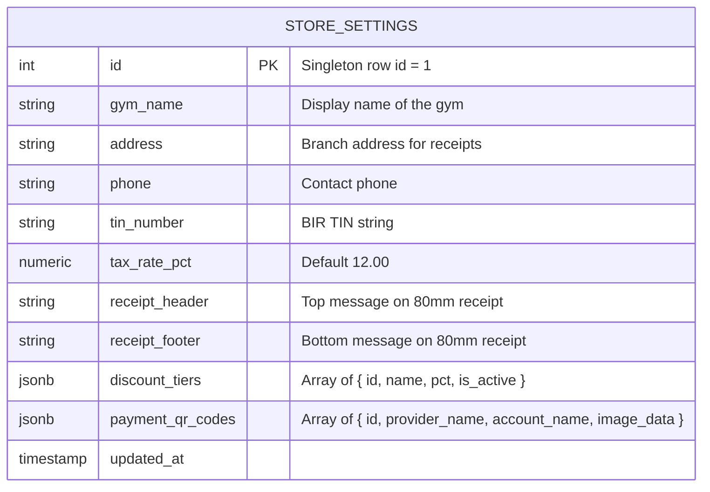
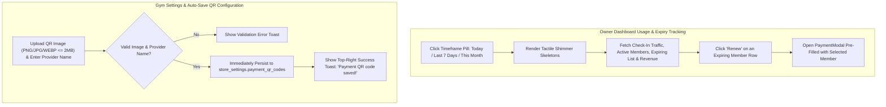

# Module 6: Owner Usage Dashboard & Gym Settings

## 1. Module Overview
This module provides the business owner (`ADMIN`) with a real-time executive dashboard tracking **Gym Usage (Sign-In Traffic & Peak Hours)**, **Active & Expiring Memberships**, and **Membership Revenue**, paired with a **Gym Settings** screen for configuring the gym profile, 80mm receipt headers/footers, preset discount tiers, and auto-saved merchant QR codes (*GCash, Maya*).

---

## 2. Database Schema Architecture



---

## 3. Features & Capabilities Breakdown

1. **Interactive Owner Dashboard with Timeframe Filtering (`Today`, `Last 7 Days`, `This Month`):**
   * **Gym Sign-Ins (Usage KPI):** Total `GRANTED` check-ins in the selected timeframe, unique members visited, and denied check-in attempts.
   * **Active Memberships KPI:** Total active members split between Time-Based Recurring Plans and Visit Packs.
   * **Expiring Soon Action Table ($\le 7$ Days or $\le 2$ Visits Remaining):** Lists members nearing expiration with their phone number, remaining days/visits, and a 1-click **`Renew`** button that opens `PaymentModal`.
   * **Peak Gym Usage Hours Chart:** Visual bar breakdown of check-in volume by hour of day (`6 AM` to `10 PM`) so the owner knows peak gym occupancy.
   * **Membership Revenue KPI:** Total completed collections (`₱`), 12% VAT breakdown, and payment method split (`Cash` vs. `QR Digital Wallet`).
2. **Gym Profile & Live 12% VAT Receipt Sample Preview:** Edit gym name, address, phone, TIN, and receipt messages with an instant live preview showing 12% BIR VAT-inclusive sample math.
3. **Configurable Discount Tiers:** Add, toggle, or delete preset percentage discounts (e.g., *Student 10%*, *Senior/PWD 20%*) that appear as 1-tap pills in `PaymentModal`.
4. **Multi-Provider Merchant Payment QR Codes with Auto-Save:** Upload and manage multiple QR images (*GCash, Maya, InstaPay*) that auto-save immediately to `store_settings.payment_qr_codes`.

---

## 4. User Stories, Field Validation Rules & Acceptance Criteria



---

### `US-REP-01`: Track Gym Usage Traffic, Peak Hours & Expiring Memberships on Owner Dashboard
- **User Story:**  
  *As a business owner, I want to filter my dashboard across Today, Last 7 Days, and This Month to see how many members signed in, which hours are busiest, and whose memberships are expiring soon so I can follow up and renew them.*

- **Field Validation Rules (`Dashboard Query Filters`):**
  | Field | Type | Constraints & Validation Rules | Exact Validation Error Message |
  | :--- | :--- | :--- | :--- |
  | `period` | `string` | **Required.** Must be one of `'today'`, `'7d'`, or `'month'` (defaults to `'today'`). | *"Invalid dashboard timeframe filter. Choose Today, Last 7 Days, or This Month."* |

- **Behavioral Acceptance Criteria (`US-REP-01`):**
  - **AC-01.1 (Shimmer Skeleton Loading Behavior):** Switching between `Today`, `Last 7 Days`, and `This Month` renders tactile shimmer skeleton placeholders across all KPI cards and tables (never raw `"Loading..."` text).
  - **AC-01.2 (Expiring Soon Alert List Behavior):** The dashboard queries all `'ACTIVE'` subscriptions where `(end_date - CURRENT_DATE) BETWEEN 0 AND 7` OR `remaining_sessions BETWEEN 1 AND 2`, sorted by soonest expiration first. Clicking `Renew` on any row opens `PaymentModal` with that member pre-selected.
  - **AC-01.3 (Usage Accuracy Behavior):** Rejected check-ins (`DENIED_EXPIRED`, `DENIED_FROZEN`, `DENIED_NO_PLAN`) and voided payments (`status_code = 'VOIDED'`) are excluded from active usage counts and net revenue totals, and are reported separately as secondary indicators.

---

### `US-SET-01`: Configure Gym Profile, Discount Tiers & Auto-Saved Payment QR Codes
- **User Story:**  
  *As a business owner, I want to configure my gym's receipt details, preset discount buttons, and multiple GCash/Maya QR codes with auto-save so that front-desk checkouts are fast and branded.*

- **Field Validation Rules (`Gym Settings Form`, `Discount Tiers` & `Payment QR Upload`):**
  | Field | Type | Constraints & Validation Rules | Exact Validation Error Message |
  | :--- | :--- | :--- | :--- |
  | `gym_name` | `string` | **Required.** Trimmed length between `2` and `120` characters. | *"Gym name must be between 2 and 120 characters."* |
  | `address` | `string` | **Required.** Trimmed length between `5` and `250` characters. | *"Gym address must be between 5 and 250 characters."* |
  | `phone` | `string` | **Required.** `7` to `20` characters (`^[0-9+\-\s()]{7,20}$`). | *"Please enter a valid gym contact phone number."* |
  | `tin_number` | `string \| null` | **Optional.** Max `40` characters. | *"TIN number cannot exceed 40 characters."* |
  | `tax_rate_pct` | `numeric(5,2)` | **Required.** Between `0.00` and `50.00` (defaults to `12.00`). | *"Tax rate percentage must be between 0% and 50%."* |
  | `receipt_header` / `receipt_footer` | `string \| null` | **Optional.** Max `200` characters each. | *"Receipt header/footer cannot exceed 200 characters."* |
  | `discount_tier.name` | `string` | **Required when adding a tier.** `2` to `40` characters. | *"Discount tier name must be between 2 and 40 characters (e.g., Student 10%)."* |
  | `discount_tier.pct` | `numeric(5,2)` | **Required when adding a tier.** Between `1.00` and `100.00`. | *"Discount percentage must be between 1% and 100%."* |
  | `qr.provider_name` | `string` | **Required when adding a QR code.** `2` to `40` characters (e.g., `'GCash'`, `'Maya'`). | *"Please enter a wallet/bank provider name (2 to 40 characters)."* |
  | `qr.account_name` | `string \| null` | **Optional.** Max `80` characters. | *"Account name cannot exceed 80 characters."* |
  | `qr.image_data` | `string (Base64 / URL)` | **Required when adding a QR code.** Valid image MIME type (`image/png`, `image/jpeg`, `image/webp`) with file size $\le 2\text{ MB}$. | *"Please upload a valid PNG, JPG, or WEBP QR image under 2 MB."* |

- **Behavioral Acceptance Criteria (`US-SET-01`):**
  - **AC-01.1 (Auto-Save Merchant QR Behavior):** Uploading a new merchant QR code or clicking delete on an existing QR card immediately persists the updated `payment_qr_codes` JSONB array to the backend without requiring the user to scroll down and click a separate `"Save Settings"` button, confirming via a top-right toast: *"Payment QR code saved automatically."*
  - **AC-01.2 (Live 12% VAT-Inclusive Receipt Preview Behavior):** Editing `gym_name`, `address`, `receipt_header`, or `receipt_footer` updates the live 80mm thermal receipt preview panel on the right in real time, demonstrating a sample ₱1,500.00 membership broken down into `₱1,339.29 Net Subtotal` + `₱160.71 (12% VAT Included)`.

---

## 5. Database Schema Relational Specification

```sql
CREATE TABLE IF NOT EXISTS store_settings (
    id INT PRIMARY KEY DEFAULT 1 CHECK (id = 1),
    gym_name VARCHAR(120) NOT NULL DEFAULT 'Mad Max Gym',
    address TEXT NOT NULL DEFAULT 'BGC High Street, Taguig City, Metro Manila',
    phone VARCHAR(40) NOT NULL DEFAULT '+63 917 555 0199',
    tin_number VARCHAR(40) DEFAULT '000-123-456-000 VAT',
    tax_rate_pct NUMERIC(5, 2) NOT NULL DEFAULT 12.00 CHECK (tax_rate_pct BETWEEN 0 AND 50),
    receipt_header TEXT DEFAULT 'MAD MAX GYM • TRAIN HARD • SIGN IN FAST',
    receipt_footer TEXT DEFAULT 'Keep your receipt or QR pass to sign in at the front desk kiosk!',
    discount_tiers JSONB NOT NULL DEFAULT '[
        {"id": "disc-student", "name": "Student", "pct": 10, "is_active": true},
        {"id": "disc-senior", "name": "Senior / PWD", "pct": 20, "is_active": true}
    ]'::jsonb,
    payment_qr_codes JSONB NOT NULL DEFAULT '[]'::jsonb,
    updated_at TIMESTAMPTZ NOT NULL DEFAULT NOW()
);

INSERT INTO store_settings (id) VALUES (1) ON CONFLICT (id) DO NOTHING;
```
